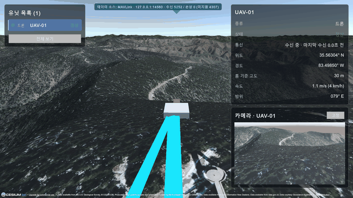
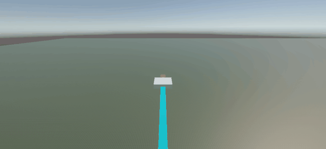
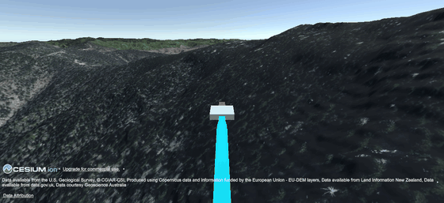
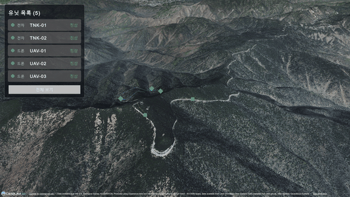
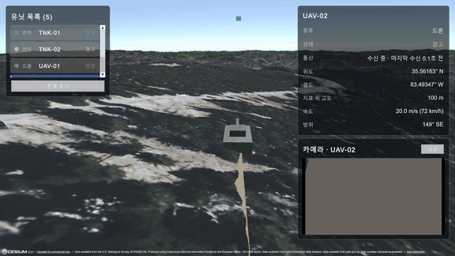
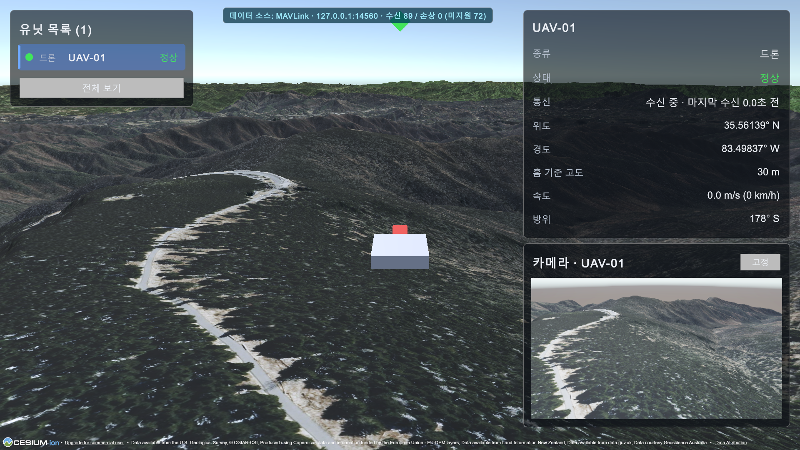
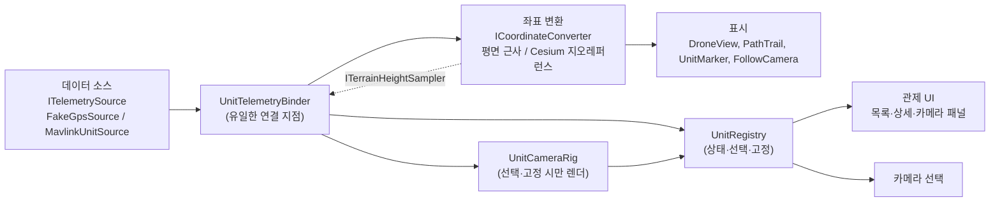

# DroneC2

드론·전차의 GPS 위치와 작전 상황을 3D 지형 위에서 보여주는 관제 시스템 포트폴리오 프로젝트입니다. Unity로 만들며, 모든 데이터는 가상 값과 공개 지형 데이터입니다. 수신·표시 전용이며 유닛에 명령을 보내는 경로는 없습니다.



*5단계 결과(약 13초). Mission Planner의 ArduPilot SITL 드론을 MAVLink로 받아 지형 위에서 움직입니다. 상단 표시줄이 현재 데이터 소스와 `수신 / 손상 (미지원)` 카운터를 항상 보여 줍니다.*

## 진행 상황

| 단계 | 내용 | 상태 |
|---|---|---|
| 1 | 평면 위 가짜 GPS 드론 이동·경로 표시 | 완료 |
| 2 | Cesium 실제 지형 위 이동, 지표 기준 고도 | 완료 |
| 3 | 다중 유닛(드론 3·전차 2) + 관제 UI | 완료 |
| 4 | 카메라 패널(선택·고정 2개), 시나리오 JSON | 완료 |
| 5 | MAVLink 시뮬레이터 연동(ArduPilot SITL), 데이터 소스 전환 | 완료 |

### 1단계 — 평면 위 가짜 GPS

가짜 GPS 소스가 웨이포인트를 따라 위경도·고도·방위·속도를 발행하고, 드론이 이를 따라 이동·회전하며 경로선이 그려집니다.



### 2단계 — Cesium 실제 지형

Cesium World Terrain 위에 위경도 기준으로 드론을 배치하고, 지형 높이를 조회해 지표 위 80m를 유지합니다. 변환기만 교체했고 표시·데이터 소스 코드는 수정하지 않았습니다.



### 3단계 — 다중 유닛 + 관제 UI

드론 3기·전차 2기를 같은 지형 위에서 움직이고, 목록에서 선택하면 카메라가 따라가며 위치·고도·속도·방위·통신 상태를 보여 줍니다. 종류는 마커 모양, 상태는 색(정상/경고/두절)으로 구분합니다. 두절은 데이터가 끊긴 것을 수신 측이 시간으로 판정합니다.



### 4단계 — 카메라 패널

유닛마다 가상 카메라(드론은 기수 앞 30° 하향, 전차는 차체 전방)를 달고, 선택한 유닛의 영상을 패널에 표시합니다. `고정`으로 한 유닛을 패널에 남겨 두면 두 유닛을 동시에 볼 수 있습니다. 카메라는 선택·고정된 유닛만 렌더하며, 렌더 중인 카메라만 Cesium 타일 선택에 등록해 타일 부담을 패널 수로 묶었습니다. 경로·고도·속도는 시나리오 JSON(`Assets/Scenarios/stage3-demo.json`)으로 읽습니다.



### 5단계 — MAVLink 시뮬레이터 연동

ArduPilot SITL(Mission Planner)이 보내는 MAVLink v1·v2 텔레메트리를 UDP로 받아 유닛을 움직입니다. 수신 전용이며 요청이나 명령을 보내지 않습니다. 데이터 소스는 설정으로 가상 GPS와 MAVLink 사이를 전환하고(Play 중 전환하면 이전 소스의 유닛을 비웁니다), MAVLink 모드에서는 가짜 GPS로 대체하지 않으며, 수신하지 못한 유닛은 화면에도 나타나지 않습니다. 고도는 홈 기준(`relative_alt`)에 홈 지형 높이를 더해 지형 위에 놓습니다.



단계별 구현·검증·겪은 문제는 [docs/devlog.md](docs/devlog.md)에 정리했습니다.

## 기술 스택

| 구분 | 내용 |
|---|---|
| 엔진 | Unity `6000.6.5f1`, URP 17.6.0, Input System 1.20.0 |
| 지형 | Cesium for Unity 1.26.0, Cesium World Terrain, Bing Maps Aerial (Cesium ion) |
| UI | UI Toolkit (런타임 UIDocument, UXML/USS) |
| 테스트 | Unity Test Framework 1.8.0 (EditMode 175건) |
| 개발 도구 | Claude Code, MCP for Unity |
| 언어 | C# |

## 설계 요약

시스템을 **데이터 소스 → 좌표 변환 → 표시** 3계층으로 나누고 계층 사이는 인터페이스로 분리했습니다. 표시 계층은 데이터가 가짜 GPS인지 MAVLink인지, 좌표 변환이 평면 근사인지 Cesium인지 알지 못합니다.



- 데이터 소스는 `ITelemetrySource`, 좌표 변환은 `ICoordinateConverter` 뒤에 둡니다.
- 소스·변환기·뷰를 잇는 곳은 `UnitTelemetryBinder` 하나뿐입니다.
- 관제 UI와 카메라 선택은 `UnitRegistry`(유닛 상태·선택·두절 판정)만 읽고 데이터 소스는 알지 못합니다.
- 지표 기준 고도(`Absolute`/`AboveGround`/`ClampToGround`)는 바인더가 계산해 변환기에 넘깁니다.
- 지형 높이는 격자 캐시와 쌍선형 보간을 거쳐 비동기 배치로 조회합니다. 캐시·보간·고도 계산은 엔진에 의존하지 않는 순수 로직이라 EditMode 테스트로 검증합니다.

자세한 구조와 다이어그램은 [docs/architecture.md](docs/architecture.md), 요구사항과 로드맵은 [docs/requirements.md](docs/requirements.md)를 참고하세요.

### 시연 지역

한국 산악 지형과 고도(최고 약 2,000m)·숲으로 덮인 능선이 비슷한 미국 그레이트 스모키 산맥 국립공원(클링맨스 돔 부근)을 시연 지역으로 사용합니다. 실제 군사 데이터와 실제 시설 좌표는 사용하지 않습니다.

## 실행 방법

### 1. 열기

1. 저장소를 내려받습니다: `git clone <저장소 URL>`
2. Unity Hub에서 Unity `6000.6.5f1`을 설치합니다.
3. Unity Hub의 **Add → Add project from disk**로 클론한 폴더를 추가하고 엽니다. 첫 열기는 패키지 해석과 임포트 때문에 5분 안팎 걸릴 수 있습니다(테스트 PC 기준).
4. 패키지는 `Packages/manifest.json`의 Cesium 레지스트리와 Git 의존성에서 자동으로 받아옵니다.

> **개발 도구 알림 — MCP for Unity:** 이 프로젝트는 개발 도구로 [MCP for Unity](https://github.com/CoplayDev/unity-mcp) 10.3.0(커밋 `aa5fc63`으로 고정)을 포함합니다. 열면 이 패키지가 에디터에서 자동으로 실행되고, PC에 설치된 AI 클라이언트의 설정 파일을 갱신할 수 있습니다(콘솔의 `refreshed N client config(s)` 로그). 이 프로젝트를 실행하는 데는 필요하지 않습니다. 원치 않으면 열기 전에 `Packages/manifest.json`에서 `com.coplaydev.unity-mcp` 줄을 지우세요.

### 2. 1단계 씬 (토큰 불필요)

`Assets/Scenes/SampleScene.unity`를 열고 Play하면 평면 위에서 가짜 GPS 드론이 움직입니다.

### 3. 2단계 씬 (Cesium ion 토큰 필요)

실제 지형은 Cesium ion에서 받으므로 **본인 Cesium ion 계정과 토큰으로 실행**해야 합니다. 토큰은 저장소에 포함되어 있지 않습니다.

1. [Cesium ion](https://ion.cesium.com)에 가입하고 Assets에서 **Cesium World Terrain**과 **Bing Maps Aerial**을 My Assets에 추가합니다.
2. Access Tokens에서 새 토큰을 만듭니다. 권한은 `assets:read`만, 접근 대상은 위 두 에셋으로 제한하는 것을 권장합니다.
3. Unity 메뉴 **Cesium → Cesium**으로 패널을 열고 **Connect to Cesium ion**으로 로그인한 뒤, **Token → Use an existing token**에서 위에서 만든 토큰을 지정합니다. (Cesium ion Assets 창과는 다른 창입니다.) 토큰은 Unity 안에서만 입력하세요.
4. `Assets/Scenes/Stage2Cesium.unity`를 열고 Play합니다. 지형 타일이 로드되는 데 잠시 걸립니다.

참고:
- 토큰이 저장되는 `Assets/CesiumSettings/` 폴더는 Cesium 패키지가 처음 열 때 자동으로 만들며, `.gitignore`에 포함되어 커밋되지 않습니다.
- 보통은 위 3번의 연결·토큰 지정만으로 지형이 나옵니다. 지형이 보이지 않으면 Cesium 패널의 연결 상태와 씬의 지형 오브젝트(`Cesium World Terrain`)의 Ion Server 지정을 확인하세요.
- 화면의 Cesium·데이터 출처 크레딧은 이용 약관상 유지해야 합니다.
- 토큰이 로그나 채팅 등에 노출되면 Cesium ion에서 폐기하고 재발급하세요. 에디터 콘솔의 `info` 로그에는 토큰이 포함된 URL이 출력될 수 있습니다. Console 창에서 Info를 숨겨도 에디터 하단 상태 표시줄에는 마지막 로그가 그대로 보이므로, 화면 공유·캡처 전에 확인하세요.

### 4. 3단계 씬 (Cesium ion 토큰 필요)

위 3절과 같은 방법으로 토큰을 연결한 뒤 `Assets/Scenes/Stage3Control.unity`를 열고 Play합니다. 왼쪽 목록에서 유닛을 클릭하면 카메라가 따라가고, `전체 보기` 버튼이나 Esc로 선택을 해제합니다. 유닛 중 일부는 시연용으로 일정 시각에 경고 또는 통신 두절 상태가 됩니다. 4단계부터 같은 씬에서 선택한 유닛의 카메라 패널이 오른쪽 아래에 나타나고, `고정` 버튼으로 왼쪽 아래 패널에 유닛 하나를 남길 수 있습니다.

### 5. MAVLink 모드 (5단계)

기본은 가상 GPS(시뮬레이션)입니다. 화면 위 가운데의 표시줄이 현재 데이터 소스와 수신 상태를 항상 보여 줍니다. MAVLink로 바꾸려면 `Stage3Control` 씬의 `TelemetrySourceSelector`에서 Mode를 `Mavlink`로 바꾼 뒤 Play합니다. Play 중에 바꿔도(Inspector에서 값을 바꾸거나 `SetMode` 호출) 이전 소스의 유닛·3D 표시·경로선·선택이 모두 비워진 뒤 새 소스의 유닛만 나타나므로 가짜와 실제 데이터가 섞이지 않습니다. 가짜 GPS로 돌아오면 시나리오를 처음부터 다시 시작합니다. MAVLink 모드에서 한 번도 수신하지 못한 유닛은 목록에 나타나지 않습니다. 이때 수신기(`MavlinkReceiver`)가 `127.0.0.1:14560`(UDP)에서 수신만 합니다. 유닛에 명령을 보내지 않습니다.

데이터를 보내는 가상 에미터는 Python 도구이며 `pymavlink`(LGPL-3.0)를 별도 프로세스로만 씁니다. 가상환경은 저장소 밖에 만듭니다.

새 가상환경을 만들어 `pip install -r tools/requirements.txt`가 되고 에미터가 실행되는 것까지 확인했습니다(Windows, Python 3.12.6). 한국어 Windows에서는 `requirements.txt`에 UTF-8 한글이 있으면 pip이 cp949로 읽다 실패하므로 이 파일은 ASCII로만 씁니다.

```powershell
# 한 번만: 저장소 밖에 가상환경을 만들고 버전을 고정한 의존성을 설치한다.
python -m venv C:\UnityProjects\DroneC2-tools\venv
C:\UnityProjects\DroneC2-tools\venv\Scripts\python.exe -m pip install -r tools/requirements.txt

# Unity가 MAVLink 모드로 Play 중일 때 저장소 루트에서 실행한다. (5기, 시나리오 stage3-demo.json 재생)
C:\UnityProjects\DroneC2-tools\venv\Scripts\python.exe tools/mavlink_emitter.py --duration 75
```

- 에미터 옵션: `--mavlink1`(v1 프레임), `--only-sysids`, `--hold-home-sysids`(홈에 정지), `--port` 등. 전체는 `--help`로 확인합니다.
- sysid와 유닛 id, 홈 위치는 `Assets/Config/MavlinkUnits.asset`의 테이블이 정하고, 에미터는 같은 값(UAV-01부터 03까지 = sysid 1–3, TNK-01·02 = sysid 4–5, 홈 35.563°N 83.499°W)을 씁니다.
- 가상환경을 지우려면 `C:\UnityProjects\DroneC2-tools\venv` 폴더를 삭제하면 됩니다(약 110MB).

#### SITL로 연결하기 (Mission Planner, 선택)

에미터 대신 실제 ArduPilot SITL을 연결하려면 Mission Planner의 SIMULATION 탭을 씁니다. 5단계에서는 ArduCopter 4.7.2로 확인했습니다. Mission Planner의 MAVLink 포워딩(UDP 출력)은 이 환경에서 오류가 나서 쓰지 않고, SITL이 Unity로 직접 보내게 했습니다.

1. SIMULATION 탭의 **Extra command line**에 `--home=35.563,-83.499,2022,0 --serial1=udpclient:127.0.0.1:14560`을 넣고 Multirotor → Stable로 시작합니다.
2. CONFIG → Full Parameter List에서 `SERIAL1_PROTOCOL`=2, `MAV2_POSITION`=4를 씁니다. 4.7에서는 스트림 설정 이름이 `SRn_*`가 아니라 `MAVn_*`이고 번호가 1부터라 `MAV2`가 SERIAL1입니다. **이 설정은 부팅할 때 적용되므로 쓴 뒤 SITL을 재시작해야 합니다.** 재시작 전에는 HEARTBEAT만 와서 유닛이 나타나지 않습니다.
3. Unity에서 모드를 `Mavlink`로 바꾸고 Play하면 UAV-01(sysid 1)이 나타납니다. Guided → Arm → Takeoff, "이곳으로 비행"으로 움직일 수 있습니다.

#### Mission Planner 설치와 제거

실제 시뮬레이터(ArduPilot SITL) 연동을 확인하려면 [Mission Planner](https://ardupilot.org/planner/docs/mission-planner-installation.html)를 씁니다. 5단계 개발에서는 1.3.83을 사용했습니다. 에미터만으로도 MAVLink 모드는 확인할 수 있어 필수가 아닙니다.

- 설치 파일: `https://firmware.ardupilot.org/Tools/MissionPlanner/MissionPlanner-latest.msi` (공식 디렉터리). 설치 파일에 서명이 없고 공식 체크섬 목록에도 없으므로, 내려받은 뒤 SHA-256을 직접 확인하세요. 개발에 쓴 파일은 `B3AC2F65196629514B2059344DA37C1E9CCD3FE85A46C3FF88BA67A55B65E4D5`이며 VirusTotal에서 0/54 탐지였습니다.
- 설치는 관리자 권한이 필요하고, 설치 중 **USB 드라이버 설치 창**이 뜹니다. 드라이버는 비행 컨트롤러 USB 연결용이라 이 프로젝트의 시뮬레이션과는 직접 관련이 없어 보입니다. 개발 중에는 드라이버를 설치한 상태로 SITL 연동을 확인했고, 설치를 거부했을 때의 동작은 확인하지 않았습니다.
- 설치 파일은 저장소 밖(`C:\UnityProjects\DroneC2-tools\downloads`)에 두었습니다. 지우려면 이 폴더(또는 `C:\UnityProjects\DroneC2-tools` 전체)를 삭제합니다.
- **제거(프로그램):** Windows `설정 > 앱 > 설치된 앱`에서 `Mission Planner`를 제거합니다. 설치 경로는 `C:\Program Files (x86)\Mission Planner`입니다.
- **제거(드라이버):** 프로그램을 지워도 USB 드라이버 패키지는 남을 수 있습니다. 설치 때 게시자 서명이 `Michael Oborne`인 패키지가 21개(`oem49.inf`–`oem72.inf` 사이, 번호는 PC마다 다름) 추가되었습니다. 관리자 PowerShell에서 먼저 목록을 확인한 뒤 지웁니다.

  ```powershell
  # 1) 서명자가 Michael Oborne인 드라이버 패키지 확인 (읽기 전용)
  pnputil /enum-drivers | Out-String | ForEach-Object { $_ -split "(\r?\n){2,}" } |
    Where-Object { $_ -match 'Michael Oborne' }

  # 2) 확인한 항목의 Published Name(oemNN.inf)마다 제거 (관리자 권한)
  pnputil /delete-driver oem49.inf /uninstall
  ```

### 6. 테스트

Unity의 Test Runner(`Window > General > Test Runner`)에서 EditMode를 실행합니다. 175건이 모두 통과해야 합니다.

## 개발 방식

이 프로젝트는 **Claude Code와 MCP for Unity로 구현**하고, **설계 검토·코드 리뷰·검증은 직접 수행**했습니다.

직접 수행한 판단과 검증의 예:

- **기준점**: 계획 검토 때 1단계 기준점을 실제 시설과 무관한 중립 좌표(공해상)로 바꿨습니다.
- **표시 설계**: 드론을 확대해 보여줄 때 루트 스케일을 키우지 않고 시각 요소(`Body`, `Nose`)만 키우도록 설계를 지정했습니다. 위치·회전 데이터와 표시를 분리하기 위해서입니다.
- **도구화**: GIF 녹화를 일회성 작업이 아니라 이후 단계에서 재사용할 수 있는 도구로 남기도록 바꿨습니다.
- **전차 경로**: 도로에 억지로 맞추지 않고, 전차는 야지 주행도 하므로 지형 경사 분석 결과(최대 경사 15° 수준)만 한계로 기록하기로 판단했습니다.
- **시연 지역**: 보안상 접경 지역을 포함한 국내 지역을 제외하고, 지형이 유사한 해외 국립공원(그레이트 스모키 산맥)을 선정했습니다.
- **비밀 값**: 로그로 노출된 Cesium ion 토큰은 즉시 재발급해 다시 연결했습니다.
- **검증**: 단계마다 테스트와 diff로 결과를 확인했습니다.

진행 방식:

- 작업을 작은 단위로 나눠 진행하고 단위마다 씬을 저장한 뒤 커밋했습니다.
- 단계가 끝날 때마다 구현 요약, 검증 결과, 겪은 문제와 해결을 [docs/devlog.md](docs/devlog.md)에 정리했습니다.
- 비밀 값은 저장소에 포함하지 않으며, 푸시 전에 커밋에서 토큰 형태 문자열을 검사했습니다.

## 보안 원칙

- 실제 군사 데이터·시설 좌표를 사용하지 않습니다. 위치·경로·식별자는 가상 값이거나 공개 데이터입니다.
- 수신·표시 전용이며 유닛에 명령을 보내는 경로를 만들지 않습니다.
- Cesium ion 토큰 등 비밀 값은 저장소에 커밋하지 않습니다.

자세한 내용은 [docs/requirements.md](docs/requirements.md)의 5·6절을 참고하세요.
