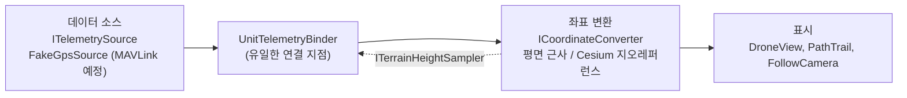

# DroneC2

드론·전차의 GPS 위치와 작전 상황을 3D 지형 위에서 보여주는 관제 시스템 포트폴리오 프로젝트입니다. Unity로 만들며, 모든 데이터는 가상 값과 공개 지형 데이터입니다. 수신·표시 전용이며 유닛에 명령을 보내는 경로는 없습니다.

*2단계 결과(18초). 드론이 코너에서 방향을 틀고 능선을 넘으며 지형을 따라 지표 위 80m를 유지합니다.*

## 진행 상황

| 단계 | 내용 | 상태 |
|---|---|---|
| 1 | 평면 위 가짜 GPS 드론 이동·경로 표시 | 완료 |
| 2 | Cesium 실제 지형 위 이동, 지표 기준 고도 | 완료 |
| 3 | 다중 유닛 + 관제 UI | 예정 |
| 4 | 카메라 패널 | 예정 |
| 5 | MAVLink 시뮬레이터 연동 | 예정 |

### 1단계 — 평면 위 가짜 GPS

가짜 GPS 소스가 웨이포인트를 따라 위경도·고도·방위·속도를 발행하고, 드론이 이를 따라 이동·회전하며 경로선이 그려집니다.

### 2단계 — Cesium 실제 지형

Cesium World Terrain 위에 위경도 기준으로 드론을 배치하고, 지형 높이를 조회해 지표 위 80m를 유지합니다. 변환기만 교체했고 표시·데이터 소스 코드는 수정하지 않았습니다.

단계별 구현·검증·겪은 문제는 [docs/devlog.md](docs/devlog.md)에 정리했습니다.

## 기술 스택

| 구분 | 내용 |
|---|---|
| 엔진 | Unity `6000.6.5f1`, URP 17.6.0, Input System 1.20.0 |
| 지형 | Cesium for Unity 1.26.0, Cesium World Terrain, Bing Maps Aerial (Cesium ion) |
| 테스트 | Unity Test Framework 1.8.0 (EditMode 35건) |
| 개발 도구 | Claude Code, MCP for Unity |
| 언어 | C# |

## 설계 요약

시스템을 **데이터 소스 → 좌표 변환 → 표시** 3계층으로 나누고 계층 사이는 인터페이스로 분리했습니다. 표시 계층은 데이터가 가짜 GPS인지 MAVLink인지, 좌표 변환이 평면 근사인지 Cesium인지 알지 못합니다.

- 데이터 소스는 `ITelemetrySource`, 좌표 변환은 `ICoordinateConverter` 뒤에 둡니다.
- 소스·변환기·뷰를 잇는 곳은 `UnitTelemetryBinder` 하나뿐입니다.
- 지표 기준 고도(`Absolute`/`AboveGround`/`ClampToGround`)는 바인더가 계산해 변환기에 넘깁니다.
- 지형 높이는 격자 캐시와 쌍선형 보간을 거쳐 비동기 배치로 조회합니다. 캐시·보간·고도 계산은 엔진에 의존하지 않는 순수 로직이라 EditMode 테스트로 검증합니다.

자세한 구조와 다이어그램은 [docs/architecture.md](docs/architecture.md), 요구사항과 로드맵은 [docs/requirements.md](docs/requirements.md)를 참고하세요.

### 시연 지역

한국 산악 지형과 고도(최고 약 2,000m)·숲으로 덮인 능선이 비슷한 미국 그레이트 스모키 산맥 국립공원(클링맨스 돔 부근)을 시연 지역으로 사용합니다. 실제 군사 데이터와 실제 시설 좌표는 사용하지 않습니다.

## 실행 방법

### 1. 열기

1. Unity Hub에서 Unity `6000.6.5f1`을 설치하고 이 저장소를 프로젝트로 엽니다.
2. 패키지는 `Packages/manifest.json`의 Cesium 레지스트리에서 자동으로 받아옵니다.

### 2. 1단계 씬 (토큰 불필요)

`Assets/Scenes/SampleScene.unity`를 열고 Play하면 평면 위에서 가짜 GPS 드론이 움직입니다.

### 3. 2단계 씬 (Cesium ion 토큰 필요)

실제 지형은 Cesium ion에서 받으므로 **본인 Cesium ion 계정과 토큰으로 실행**해야 합니다. 토큰은 저장소에 포함되어 있지 않습니다.

1. [Cesium ion](https://ion.cesium.com)에 가입하고 Assets에서 **Cesium World Terrain**과 **Bing Maps Aerial**을 My Assets에 추가합니다.
2. Access Tokens에서 새 토큰을 만듭니다. 권한은 `assets:read`만, 접근 대상은 위 두 에셋으로 제한하는 것을 권장합니다.
3. Unity의 Cesium 패널에서 Cesium ion에 연결하고 토큰을 지정합니다. 토큰은 Unity 안에서만 입력하세요.
4. `Assets/Scenes/Stage2Cesium.unity`를 열고 Play합니다. 지형 타일이 로드되는 데 잠시 걸립니다.

참고:
- 토큰이 저장되는 `Assets/CesiumSettings/` 폴더는 `.gitignore`에 포함되어 커밋되지 않습니다.
- 씬이 참조하는 Cesium ion 서버 설정은 개발 PC의 무시된 파일에 연결되어 있어 다른 환경에서는 비어 있을 수 있습니다. 지형이 보이지 않으면 Cesium 패널의 연결 상태와 씬의 지형 오브젝트(`Cesium World Terrain`)의 Ion Server 지정을 확인하세요.
- 화면의 Cesium·데이터 출처 크레딧은 이용 약관상 유지해야 합니다.
- 토큰이 로그나 채팅 등에 노출되면 Cesium ion에서 폐기하고 재발급하세요. 에디터 콘솔의 `info` 로그에는 토큰이 포함된 URL이 출력될 수 있습니다.

### 4. 테스트

Unity의 Test Runner(`Window > General > Test Runner`)에서 EditMode를 실행합니다. 35건이 모두 통과해야 합니다.

## 개발 방식

이 프로젝트는 **Claude Code와 MCP for Unity로 구현**하고, **설계 검토·코드 리뷰·검증은 직접 수행**했습니다.

직접 수행한 판단과 검증의 예:

- **기준점**: 계획 검토 때 1단계 기준점을 실제 시설과 무관한 중립 좌표(공해상)로 바꿨습니다.
- **표시 설계**: 드론을 확대해 보여줄 때 루트 스케일을 키우지 않고 시각 요소(`Body`, `Nose`)만 키우도록 설계를 지정했습니다. 위치·회전 데이터와 표시를 분리하기 위해서입니다.
- **도구화**: GIF 녹화를 일회성 작업이 아니라 이후 단계에서 재사용할 수 있는 도구로 남기도록 바꿨습니다.
- **시연 지역**: 보안상 접경 지역을 포함한 국내 지역을 제외하고, 지형이 유사한 해외 국립공원(그레이트 스모키 산맥)을 선정했습니다.
- **비밀 값**: 로그로 노출된 Cesium ion 토큰은 즉시 재발급해 다시 연결했습니다.
- **검증**: 단계마다 테스트와 diff로 결과를 확인했습니다.

진행 방식:

- 작업을 작은 단위로 나눠 진행하고 단위마다 씬을 저장한 뒤 커밋했습니다.
- 단계가 끝날 때마다 구현 요약, 검증 결과, 겪은 문제와 해결을 [docs/devlog.md](docs/devlog.md)에 정리했습니다.
- 비밀 값은 저장소에 포함하지 않으며, 푸시 전에 커밋에서 토큰 형태 문자열을 검사했습니다.

## 보안 원칙

- 실제 군사 데이터·시설 좌표를 사용하지 않습니다. 위치·경로·식별자는 가상 값이거나 공개 데이터입니다.
- 수신·표시 전용이며 유닛에 명령을 보내는 경로를 만들지 않습니다.
- Cesium ion 토큰 등 비밀 값은 저장소에 커밋하지 않습니다.

자세한 내용은 [docs/requirements.md](docs/requirements.md)의 5·6절을 참고하세요.
