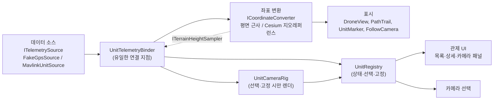

# DroneC2

드론·전차의 GPS 위치와 작전 상황을 실제 지형 위 3D로 보여 주는 관제 시스템입니다. Unity로 만들었고, 수신·표시 전용이며 유닛에 명령을 보내는 경로는 없습니다. 모든 데이터는 가상 값과 공개 데이터입니다.

*약 12초. 전차가 OpenStreetMap의 실제 포장도로를 따라 달립니다(도로 중심선에서 평균 0.3–0.6m, 최대 1.5m). ArduPilot SITL 드론을 MAVLink로 받아 움직이는 장면은 [SITL 연동 GIF](docs/images/stage5-mavlink-sitl.gif)에서 볼 수 있습니다.*

## 주요 기능

- **실제 지형 위 다중 유닛:** Cesium World Terrain 위에서 드론 3기·전차 2기를 동시에 표시하고 경로선을 그립니다.
- **산악 지형에 맞춘 고도 처리:** 드론은 이륙 지점(홈) 기준 상대고도에 홈 지형 높이를 더해 놓고, 전차는 지면에 밀착시킵니다. 지형 높이는 격자 캐시와 보간으로 조회합니다.
- **관제 UI:** 유닛 목록, 위치·고도·속도·방위 상세 패널, 정상/경고/두절 상태를 보여 줍니다. 두절은 수신 측이 2초 무수신으로 판정합니다.
- **카메라 패널:** 유닛마다 가상 카메라가 있고, 선택한 유닛과 고정한 유닛의 영상을 동시에 볼 수 있습니다.
- **데이터 소스 전환:** 가상 GPS와 MAVLink(ArduPilot SITL, 드론·전차 모두 확인) 사이를 설정으로 바꿉니다. Play 중에 바꾸면 이전 소스의 유닛·표시를 모두 비웁니다.
- **실제 도로 경로:** 전차 경로를 OpenStreetMap의 실제 도로에서 만들었습니다.

시연 지역은 미국 그레이트 스모키 산맥 국립공원(클링맨스 돔 부근)입니다. 한국 산악 지형과 고도·숲 능선이 비슷한 대체 지역이며, 실제 군사 데이터와 시설 좌표는 쓰지 않습니다.

## 3계층 구조

시스템을 **데이터 소스 → 좌표 변환 → 표시** 3계층으로 나누고 계층 사이는 인터페이스로 분리했습니다. 표시 계층은 데이터가 가짜 GPS인지 MAVLink인지, 좌표 변환이 평면 근사인지 Cesium인지 알지 못합니다.

소스·변환기·뷰를 잇는 곳은 `UnitTelemetryBinder` 하나뿐이고, 관제 UI는 `UnitRegistry`만 읽습니다. 자세한 구조는 [docs/architecture.md](docs/architecture.md), 요구사항과 로드맵은 [docs/requirements.md](docs/requirements.md)를 보세요.

## 기술적으로 눈여겨볼 점

- **MAVLink 해석기를 외부 라이브러리 없이 직접 구현했습니다.** v1·v2 프레임을 모두 파싱하고, 메시지별 CRC_EXTRA로 CRC를 검증하며, v2가 생략한 끝 0바이트는 메시지 정의 길이로 복원합니다. 미지원 메시지와 손상 프레임을 구분해 세고, 수신은 전용 스레드와 크기 제한이 있는 큐로 받아 메인 스레드에서 비웁니다.
- **pymavlink가 만든 프레임으로 교차 검증했습니다.** pymavlink 에미터의 MAVLink v2 데이터그램 4,037개를 Unity가 받아 손상 0건이었습니다. v1은 단위 테스트로 검증했습니다.
- **변환기를 바꿔도 다른 계층은 수정하지 않았습니다.** 평면 근사에서 Cesium으로 바꿀 때 표시·데이터 소스 코드를 건드리지 않았습니다.
- **MAVLink 모드에서는 가짜 GPS로 대체하지 않습니다.** 관제 화면에서 가짜 데이터를 실제처럼 보여 주는 것이 가장 위험하다는 판단입니다. 수신기가 없으면 가짜 GPS로 바꾸지 않고 오류를 표시하며, 수신이 끊기면 2초 뒤 두절로 표시합니다.
- **이동을 "속도 × 경과 시간"으로 계산합니다.** 경로 길이를 기준으로 위치·방위를 구해 코너를 깎지 않고, C#과 파이썬이 같은 기준값 파일로 같은 위치를 내는지 대조합니다.
- **측정으로 확인했습니다.** 전차가 도로 중심선에서 평균 0.3–0.6m(최대 1.5m) 이내를 달리고, 카메라는 선택·고정된 유닛만 렌더해 Cesium 타일 부담을 패널 수로 묶었습니다. 엔진에 의존하지 않는 순수 로직은 EditMode 테스트 184건으로 검증합니다.
- **전차(ArduRover) SITL을 실측했습니다.** 도로 경로를 Mission Planner 미션으로 바꿔 Auto 모드로 한 바퀴(1,995m) 주행시켰을 때 도로 이탈은 평균 0.32m·최대 1.90m(5 m/s, `WP_RADIUS` 3)였고, SITL을 끄자 마지막 수신 후 2.002초에 두절로 바뀌었습니다.
- **공개 전에 검증했습니다.** README만 보고 새 폴더에 클론해 실행하는 테스트로 한국어 Windows의 인코딩 오류(pip의 cp949 읽기 실패), 제3자 패키지 때문에 Play 중 프레임이 끊기는 문제 등을 찾아 고쳤습니다. 전체 git 기록과 문서 이미지에서 토큰·개인정보를 검사했습니다.

## 실행 방법

1. 저장소를 클론하고 Unity Hub에서 Unity `6000.6.5f1`으로 프로젝트를 엽니다(첫 열기 5분 안팎).
2. `Assets/Scenes/SampleScene.unity`를 열고 Play하면 토큰 없이 평면 위 가짜 GPS 드론을 볼 수 있습니다.
3. 실제 지형(`Stage2Cesium`, `Stage3Control` 씬)은 **본인 Cesium ion 토큰**이 필요합니다. 토큰은 저장소에 없습니다.

토큰 연결, MAVLink 에미터·ArduPilot SITL(Mission Planner) 연동, 테스트 실행은 [docs/setup.md](docs/setup.md)에 정리했습니다.

## 알려진 한계

- 지상 유닛(전차)이 렌더된 지형에서 약 ±4m 뜨거나 파묻혀 보일 수 있습니다.
- MAVLink 모드에서 한 번도 수신하지 못한 유닛은 목록에 나타나지 않습니다.
- 통신 두절 상태에서도 상세 패널은 마지막 속도·위치를 그대로 보여 줍니다.
- 3D 오브젝트를 클릭해 선택할 수 없고(목록에서만 선택), 카메라 고정은 1기까지입니다.
- SITL은 드론(ArduCopter)과 전차(ArduRover)를 각각 1기씩만, 동시에 켜지 않고 확인했습니다. 전차 자율 주행은 5 m/s에서만 측정했습니다.

## 개발 방식

Claude Code와 함께 개발했고, 설계 결정과 검증은 직접 했습니다. 직접 내린 판단과 진행 방식은 [docs/process.md](docs/process.md)에 정리했습니다.

## 단계별 기록

1–6단계 결과와 GIF는 [docs/stages.md](docs/stages.md), 구현·검증·겪은 문제는 [docs/devlog.md](docs/devlog.md)에 있습니다.

## 데이터 출처와 라이선스

- **지형·영상:** Cesium World Terrain과 Bing Maps Aerial을 Cesium ion으로 받습니다. 화면의 크레딧은 이용 약관상 유지해야 합니다.
- **전차 경로(OpenStreetMap):** 전차(TNK-01·02) 경로는 OpenStreetMap의 도로 `Kuwohi Access Road`에서 만든 파생 데이터입니다. **© OpenStreetMap contributors**, [Open Database License(ODbL) 1.0](https://opendatacommons.org/licenses/odbl/1-0/)으로 제공됩니다. 저작권·라이선스 안내는 <https://www.openstreetmap.org/copyright>를 참고하세요.
  - 경로 파일 `Assets/Scenarios/osm-roads-tnk.json`은 OSM 데이터에서 파생한 데이터베이스라서 ODbL(출처 표기, 같은 조건으로 공유)을 따릅니다. 프로젝트의 나머지 코드·시나리오와 섞이지 않도록 별도 파일로 분리했고, 파일 안에도 출처 문구(`attribution`)와 OSM 데이터 기준 시각이 들어 있습니다.
  - 원본 응답(`tools/osm/roads-raw.json`)과 질의문(`tools/osm/roads.overpassql`), 변환 스크립트(`tools/osm_to_scenario.py`)를 함께 두어 같은 결과를 다시 만들 수 있습니다. 자세한 내용은 `tools/osm/README.md`를 보세요.
  - 전차와 모든 유닛은 가상입니다. 도로 좌표는 공개 지도 데이터이며 실제 시설이나 군사 자료가 아닙니다.

## 보안 원칙

- 실제 군사 데이터·시설 좌표를 사용하지 않습니다. 위치·경로·식별자는 가상 값이거나 공개 데이터입니다.
- 수신·표시 전용이며 유닛에 명령을 보내는 경로를 만들지 않습니다.
- Cesium ion 토큰 등 비밀 값은 저장소에 커밋하지 않습니다.

자세한 내용은 [docs/requirements.md](docs/requirements.md)의 5·6절을 참고하세요.
