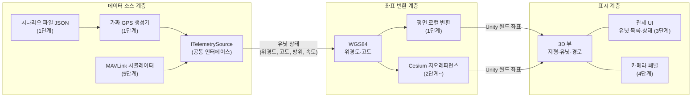
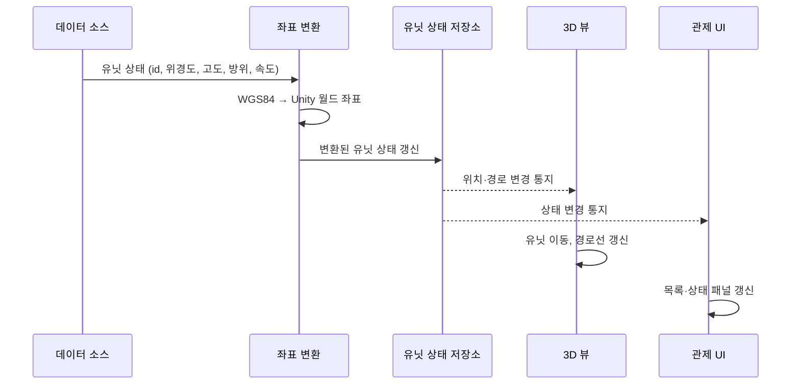

# DroneC2 시스템 구조

- 버전: v0.1 (초안)
- 상태: 설계 단계 — 클래스명·버전은 예정 사항이며 구현 중 변경될 수 있다.

## 1. 설계 원칙

시스템을 **데이터 소스 / 좌표 변환 / 표시** 3개 계층으로 분리한다.

- 의존 방향은 데이터 소스 → 좌표 변환 → 표시의 **단방향**이다.
- 표시 계층은 데이터가 가짜 GPS인지 MAVLink인지 알지 못한다.
- 데이터 소스는 공통 인터페이스(예정: `ITelemetrySource`)로 교체할 수 있다.

## 2. 계층 구조

## 3. 데이터 흐름

한 프레임(또는 한 텔레메트리 주기)에서의 흐름이다.

## 4. 단계별 구성 변화

| 단계 | 데이터 소스 | 좌표 변환 | 표시 |
|---|---|---|---|
| 1 | 가짜 GPS + 시나리오 JSON | 평면 로컬 변환 | 평면 위 드론, 경로선 |
| 2 | 동일 | Cesium 지오레퍼런스 | 실제 지형 위 유닛 |
| 3 | 다중 유닛 가짜 GPS | 동일 | 다중 유닛 + 관제 UI |
| 4 | 동일 | 동일 | + 카메라 패널 |
| 5 | + MAVLink 시뮬레이터 | 동일 | 동일 (소스 전환만 변경) |

## 5. 계층별 책임

| 계층 | 책임 | 하지 않는 일 |
|---|---|---|
| 데이터 소스 | 유닛 상태를 위경도 기준으로 생성·수신하여 공통 형식으로 전달 | Unity 좌표 변환, 화면 표시 |
| 좌표 변환 | WGS84 ↔ Unity 월드 좌표 변환, 지형 고도 보정 | 데이터 생성, UI 처리 |
| 표시 | 유닛·경로·UI·카메라 패널 렌더링 | 데이터 소스 종류 판별, 좌표 계산 |

## 6. 범위와 보안

수신·표시 전용 구조이며 유닛에 명령을 보내는 경로는 없다. 모든 데이터는 가상·공개 데이터다.
자세한 내용은 [requirements.md](requirements.md)의 5, 6절을 참고한다.
