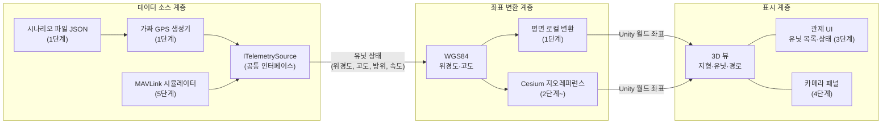
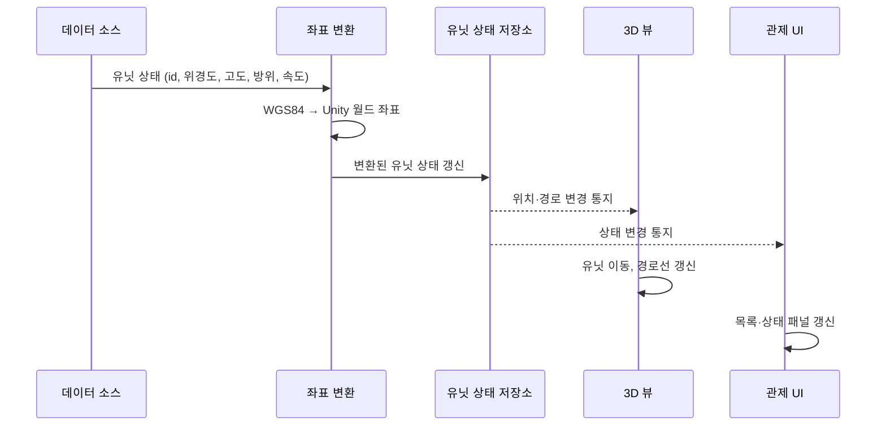
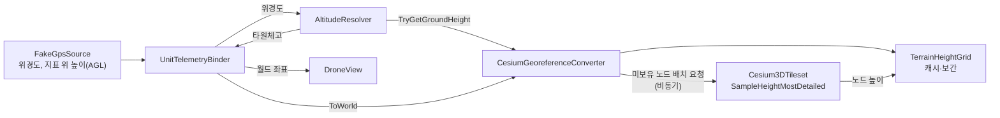

# DroneC2 시스템 구조

- 버전: v0.3 (초안)
- 상태: 2단계 구현 반영 — 3단계 이후 클래스명·버전은 예정 사항이며 구현 중 변경될 수 있다.

## 1. 설계 원칙

시스템을 **데이터 소스 / 좌표 변환 / 표시** 3개 계층으로 분리한다.

- 의존 방향은 데이터 소스 → 좌표 변환 → 표시의 **단방향**이다.
- 표시 계층은 데이터가 가짜 GPS인지 MAVLink인지 알지 못한다.
- 데이터 소스는 공통 인터페이스 `ITelemetrySource`로, 좌표 변환은 `ICoordinateConverter`로 교체할 수 있다.

## 2. 계층 구조

## 3. 데이터 흐름

한 프레임(또는 한 텔레메트리 주기)에서의 흐름이다.

## 4. 단계별 구성 변화

| 단계 | 데이터 소스 | 좌표 변환 | 표시 |
|---|---|---|---|
| 1 (완료) | 가짜 GPS (웨이포인트는 인스펙터 입력, 시나리오 JSON은 미구현) | 평면 로컬 변환 | 평면 위 드론, 경로선, 추적 카메라 |
| 2 (완료) | 동일 | Cesium 지오레퍼런스 + 지표 높이 조회 | 실제 지형 위 유닛 (표시 계층 변경 없음) |
| 3 | 다중 유닛 가짜 GPS | 동일 | 다중 유닛 + 관제 UI |
| 4 | 동일 | 동일 | + 카메라 패널 |
| 5 | + MAVLink 시뮬레이터 | 동일 | 동일 (소스 전환만 변경) |

## 5. 계층별 책임

| 계층 | 책임 | 하지 않는 일 |
|---|---|---|
| 데이터 소스 | 유닛 상태를 위경도 기준으로 생성·수신하여 공통 형식으로 전달 | Unity 좌표 변환, 화면 표시 |
| 좌표 변환 | WGS84 ↔ Unity 월드 좌표 변환, 지형 고도 보정 | 데이터 생성, UI 처리 |
| 표시 | 유닛·경로·UI·카메라 패널 렌더링 | 데이터 소스 종류 판별, 좌표 계산 |

> 주의: 5단계 MAVLink 수신은 별도 스레드에서 이뤄질 수 있으므로, 데이터 소스에서 표시 계층으로 넘길 때 메인 스레드 전달(큐 등)이 필요하다. (구현은 5단계)

## 6. 1단계 구현 현황

런타임 코드는 `Assets/Scripts/<역할>/`, 테스트는 `Assets/Tests/EditMode/`에 있다. 어셈블리는 `DroneC2.Runtime`.

| 계층 | 구성 요소 | 역할 |
|---|---|---|
| 데이터 소스 | `TelemetrySample`, `ITelemetrySource`, `FakeGpsSource` | 위경도 기준 샘플 구조체, 소스 인터페이스(이벤트 푸시), 웨이포인트 순환 가짜 GPS |
| 좌표 변환 | `ICoordinateConverter`, `LocalTangentPlaneConverter` | 위경도·고도 → 월드 좌표(x=동, y=고도, z=북), 방위각 → 회전 |
| 표시 | `DroneView`, `PathTrail`, `FollowCamera` | 보간 이동·회전, 경로선, 뒤·위 추적 카메라 (월드 좌표만 사용) |
| 연결 | `UnitTelemetryBinder` | 소스 → 변환기 → 뷰를 잇는 유일한 지점 |

2단계에서는 `ICoordinateConverter`(Cesium) 구현체를 추가하고 표시·데이터 소스 계층은 수정하지 않았다. 5단계에서도 `ITelemetrySource`(MAVLink) 구현체만 추가·교체하는 것을 목표로 한다.

## 7. 2단계 구현 현황

어셈블리는 `DroneC2.Runtime`이며 Cesium for Unity 1.26.0(`CesiumForUnity`)과 `Unity.Mathematics`를 참조한다.

| 계층 | 구성 요소 | 역할 |
|---|---|---|
| 좌표 변환 | `CesiumGeoreferenceConverter` | 위경도·타원체고 → ECEF → 지오레퍼런스 기준 Unity 월드 좌표. `ICoordinateConverter`와 `ITerrainHeightSampler` 구현 |
| 좌표 변환 | `ITerrainHeightSampler`, `TerrainHeightGrid` | 지표 높이 조회 인터페이스, 격자 캐시·쌍선형 보간(엔진·Cesium 비의존 순수 로직) |
| 연결 | `UnitTelemetryBinder`, `AltitudeMode`, `AltitudeResolver` | 고도 모드(`Absolute`/`AboveGround`/`ClampToGround`)에 따라 변환기에 넘길 고도를 계산 |
| 표시 | `DroneView.HasTarget` | 첫 배치 여부 노출. `PathTrail`이 배치 전 위치를 기록하지 않게 한다 |

- 지표 높이는 비동기로 도착한다. 값이 없으면 마지막 유효 값을 쓰고, 한 번도 얻지 못했으면 그 샘플은 건너뛴다. 평면 변환기(샘플러 없음)에서는 지표를 높이 0 평면으로 간주한다.
- 격자 간격은 0.0002°(약 18~22m)이며, 보간에 필요한 2x2 바깥 2노드를 미리 요청해 이동 방향을 선읽기한다.
- 고도 의미는 모드가 정한다. `FakeGpsSource`는 지형을 알지 못하며 값(80m)을 지표 위 높이로 해석하는 것은 바인더 설정이다.

### 한계

- 지형 높이 조회 지연은 측정하지 못했다.
- 높이 캐시에 상한이 없다.
- 타원체고와 해발 고도(지오이드 기준)는 다르다. 기준점에서 약 30m 차이가 난다.
- `HeadingToRotation`은 위치를 받지 않아 원점 기준 ENU 회전을 쓴다. 원점에서 멀어지면 곡률 오차가 생긴다(5km에서 약 0.05°).

## 8. 범위와 보안

수신·표시 전용 구조이며 유닛에 명령을 보내는 경로는 없다. 모든 데이터는 가상·공개 데이터다.
자세한 내용은 [requirements.md](requirements.md)의 5, 6절을 참고한다.
