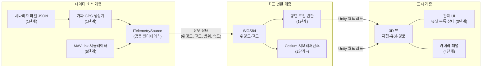
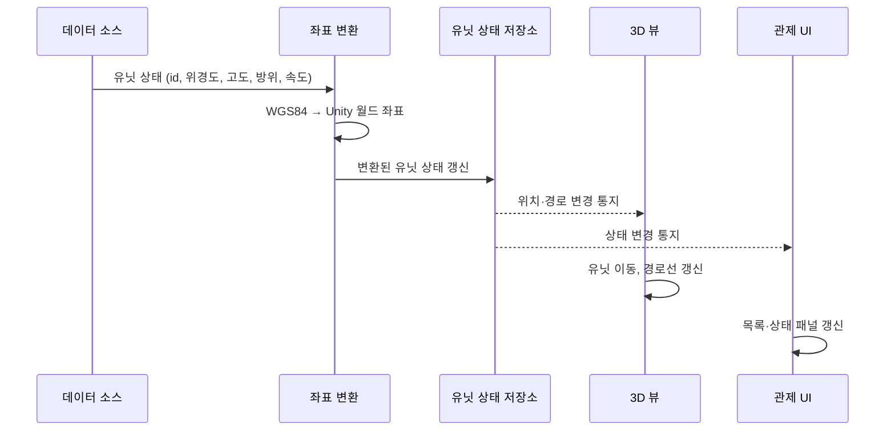
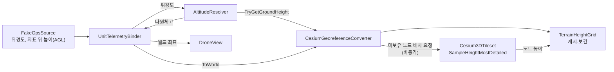
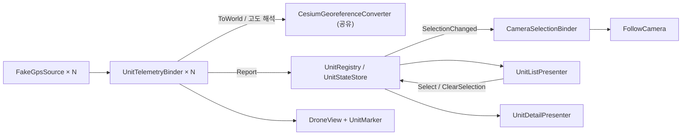
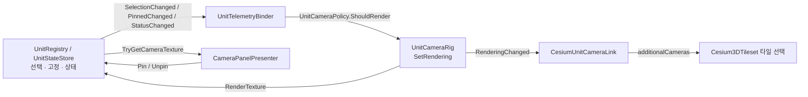
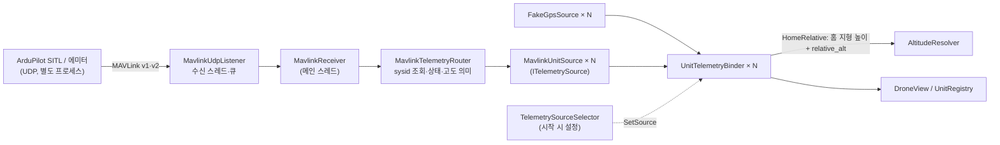

# DroneC2 시스템 구조

- 버전: v0.6 (초안)
- 상태: 5단계 구현 반영 — 6단계 이후 클래스명·버전은 예정 사항이며 구현 중 변경될 수 있다.

## 1. 설계 원칙

시스템을 **데이터 소스 / 좌표 변환 / 표시** 3개 계층으로 분리한다.

- 의존 방향은 데이터 소스 → 좌표 변환 → 표시의 **단방향**이다.
- 표시 계층은 데이터가 가짜 GPS인지 MAVLink인지 알지 못한다.
- 데이터 소스는 공통 인터페이스 `ITelemetrySource`로, 좌표 변환은 `ICoordinateConverter`로 교체할 수 있다.

## 2. 계층 구조

## 3. 데이터 흐름

한 프레임(또는 한 텔레메트리 주기)에서의 흐름이다.

## 4. 단계별 구성 변화

| 단계 | 데이터 소스 | 좌표 변환 | 표시 |
|---|---|---|---|
| 1 (완료) | 가짜 GPS (웨이포인트는 인스펙터 입력, 시나리오 JSON은 미구현) | 평면 로컬 변환 | 평면 위 드론, 경로선, 추적 카메라 |
| 2 (완료) | 동일 | Cesium 지오레퍼런스 + 지표 높이 조회 | 실제 지형 위 유닛 (표시 계층 변경 없음) |
| 3 (완료) | 다중 유닛 가짜 GPS(드론 3·전차 2, 결함 주입) | 동일 (변환기 하나를 모든 유닛이 공유) | 다중 유닛 + 마커 + 관제 UI(목록·상세) |
| 4 (완료) | 동일 + 시나리오 JSON 로딩 | 동일 | + 유닛 가상 카메라와 카메라 패널(선택·고정) |
| 5 (완료) | + MAVLink 시뮬레이터(UDP 수신, sysid별 소스). 시작 시 설정으로 가짜 GPS와 전환 | 동일 (`HomeRelative` 고도 모드만 추가) | 동일 (수신 전 유닛 숨김, 데이터 소스 표시줄 추가) |

## 5. 계층별 책임

| 계층 | 책임 | 하지 않는 일 |
|---|---|---|
| 데이터 소스 | 유닛 상태를 위경도 기준으로 생성·수신하여 공통 형식으로 전달 | Unity 좌표 변환, 화면 표시 |
| 좌표 변환 | WGS84 ↔ Unity 월드 좌표 변환, 지형 고도 보정 | 데이터 생성, UI 처리 |
| 표시 | 유닛·경로·UI·카메라 패널 렌더링 | 데이터 소스 종류 판별, 좌표 계산 |

> 5단계 MAVLink 수신은 별도 스레드에서 이뤄지므로 데이터 소스에서 표시 계층으로 넘길 때 메인 스레드 전달(상한 있는 큐)을 거친다.

## 6. 1단계 구현 현황

런타임 코드는 `Assets/Scripts/<역할>/`, 테스트는 `Assets/Tests/EditMode/`에 있다. 어셈블리는 `DroneC2.Runtime`.

| 계층 | 구성 요소 | 역할 |
|---|---|---|
| 데이터 소스 | `TelemetrySample`, `ITelemetrySource`, `FakeGpsSource` | 위경도 기준 샘플 구조체, 소스 인터페이스(이벤트 푸시), 웨이포인트 순환 가짜 GPS |
| 좌표 변환 | `ICoordinateConverter`, `LocalTangentPlaneConverter` | 위경도·고도 → 월드 좌표(x=동, y=고도, z=북), 방위각 → 회전 |
| 표시 | `DroneView`, `PathTrail`, `FollowCamera` | 보간 이동·회전, 경로선, 뒤·위 추적 카메라 (월드 좌표만 사용) |
| 연결 | `UnitTelemetryBinder` | 소스 → 변환기 → 뷰를 잇는 유일한 지점 |

2단계에서는 `ICoordinateConverter`(Cesium) 구현체를 추가하고 표시·데이터 소스 계층은 수정하지 않았다. 5단계에서도 `ITelemetrySource`(MAVLink) 구현체(`MavlinkUnitSource`)만 추가했고 표시 코드는 소스 교체 때문에 고치지 않았다.

## 7. 2단계 구현 현황

어셈블리는 `DroneC2.Runtime`이며 Cesium for Unity 1.26.0(`CesiumForUnity`)과 `Unity.Mathematics`를 참조한다.

| 계층 | 구성 요소 | 역할 |
|---|---|---|
| 좌표 변환 | `CesiumGeoreferenceConverter` | 위경도·타원체고 → ECEF → 지오레퍼런스 기준 Unity 월드 좌표. `ICoordinateConverter`와 `ITerrainHeightSampler` 구현 |
| 좌표 변환 | `ITerrainHeightSampler`, `TerrainHeightGrid` | 지표 높이 조회 인터페이스, 격자 캐시·쌍선형 보간(엔진·Cesium 비의존 순수 로직) |
| 연결 | `UnitTelemetryBinder`, `AltitudeMode`, `AltitudeResolver` | 고도 모드(`Absolute`/`AboveGround`/`ClampToGround`)에 따라 변환기에 넘길 고도를 계산 |
| 표시 | `DroneView.HasTarget` | 첫 배치 여부 노출. `PathTrail`이 배치 전 위치를 기록하지 않게 한다 |

- 지표 높이는 비동기로 도착한다. 값이 없으면 마지막 유효 값을 쓰고, 한 번도 얻지 못했으면 그 샘플은 건너뛴다. 평면 변환기(샘플러 없음)에서는 지표를 높이 0 평면으로 간주한다.
- 격자 간격은 0.0002°(약 18–22m)이며, 보간에 필요한 2x2 바깥 2노드를 미리 요청해 이동 방향을 선읽기한다.
- 고도 의미는 모드가 정한다. `FakeGpsSource`는 지형을 알지 못하며 값(80m)을 지표 위 높이로 해석하는 것은 바인더 설정이다.

### 한계

- 지형 높이 조회 지연은 측정하지 못했다.
- 높이 캐시에 상한이 없다.
- 타원체고와 해발 고도(지오이드 기준)는 다르다. 기준점에서 약 30m 차이가 난다.
- `HeadingToRotation`은 위치를 받지 않아 원점 기준 ENU 회전을 쓴다. 원점에서 멀어지면 곡률 오차가 생긴다(5km에서 약 0.05°).

## 8. 3단계 구현 현황

| 계층 | 구성 요소 | 역할 |
|---|---|---|
| 데이터 소스 | `UnitKind`, `UnitStatus`, `TelemetrySample` | 종류·상태를 샘플에 실음. 상태는 Normal/Warning을 소스가 보고하고 Lost는 수신 측이 붙임 |
| 연결 | `UnitStateStore`, `UnitRegistry` | 샘플 수신, 두절 판정(마지막 수신 후 2초), 선택 상태. 판정 로직은 순수 클래스, 시계·Transform 조회는 MonoBehaviour |
| 연결 | `UnitTelemetryBinder`, `CameraSelectionBinder` | 바인더가 레지스트리·마커에 보고, 선택 상태를 카메라 대상에 연결 |
| 표시 | `UnitMarker`, `FollowCamera.SetTarget` | 종류·상태를 모양·색으로 표시하는 빌보드, 대상이 없으면 전체 보기 |
| UI | `UnitListPresenter`, `UnitDetailPresenter`, `UnitFormat` | UI Toolkit 목록·상세 패널. 레지스트리만 읽음 |

- 계층 의존은 단방향이다: DataSource는 Core를 참조하지 않고, Core·View·UI가 DataSource 타입을 참조한다.
- 선택 상태는 `UnitStateStore.Select` 한 곳에만 있어 목록 클릭, 마커 강조, 카메라 추적이 같은 경로를 탄다.
- 두절은 "샘플이 오지 않음"을 시간으로 판정한다. 소스용(`ReportedStatus`: Normal/Warning)과 표시용(`UnitStatus`: +Lost) enum은 5단계에서 분리했다.

### 한계

- 상세 패널의 고도는 샘플이 보고한 값이며, `Absolute` 값은 WGS84 타원체고다(해발 고도와 약 30m 차이).
- 지표 높이 캐시 상한이 없다(10기 약 1분 15초에 2,222노드).
- 3D 오브젝트 클릭 선택은 구현하지 않았다. 선택은 목록·전체 보기 버튼·Esc로 한다.

## 9. 4단계 구현 현황

| 계층 | 구성 요소 | 역할 |
|---|---|---|
| 데이터 소스 | `Scenario`, `FakeGpsSource.scenarioJson` | 경로·고도·속도·종류·결함 구간을 JSON에서 읽고 검증. `FakeGpsSource`가 유닛 id로 항목을 찾아 적용 |
| 표시 | `UnitCameraRig` | 유닛 자식 카메라 + `RenderTexture`. `SetRendering`으로 켠 동안만 렌더, 상태 변화는 `RenderingChanged`로 알림 |
| 표시 | `CesiumUnitCameraLink` | 렌더 중인 유닛 카메라를 Cesium 타일 선택 카메라에 등록·해제 |
| 연결 | `UnitCameraPolicy`, `UnitStateStore.Pin`, `UnitRegistry.TryGetCameraTexture` | 렌더 규칙(순수 함수), 고정 상태, 유닛별 영상 텍스처 조회 |
| UI | `CameraPanelPresenter` | 선택 패널·고정 패널, 고정/해제 버튼, 두절 오버레이. 레지스트리만 읽음 |

- 카메라 렌더 규칙은 "선택되었거나 고정되었고 두절이 아니면 렌더"이며, 규칙은 엔진 비의존 순수 함수라 EditMode에서 검증한다.
- `UnitCameraRig`는 Cesium을 알지 못하고, 렌더 중인 카메라만 타일 선택에 올리는 일은 `CesiumUnitCameraLink`가 맡는다. 결합 지점이 한 곳이다.
- 별도 시점을 렌더하므로 렌더 비용과 함께 그 시점의 타일 선택 비용을 낸다. 등록 수가 패널 수(최대 2)로 묶인다.

### 한계

- 고정은 1기(패널 2개)까지다. 카메라 영상은 가상이며 해상도는 640×360 고정이다.
- 카메라를 Cesium에 등록하면 타일·메모리가 늘고, 등록 직후 로딩 구간에 정지가 한 번 관측됐다(2대, 262ms).
- 시나리오는 시작 시점에 한 번 읽어 적용한다. 고도 모드는 시나리오에 없고 바인더 설정이다.

## 10. 5단계 구현 현황

| 계층 | 구성 요소 | 역할 |
|---|---|---|
| 데이터 소스 | `MavlinkParser`, `MavlinkDecoder`, `MavlinkFrame` | v1·v2 프레임 추출(CRC·잘린 v2 페이로드·서명 길이). HEARTBEAT·GLOBAL_POSITION_INT만 해석. 사유별 카운터: `V1Frames`/`V2Frames`, `Unsupported`(정상 미지원 메시지), `Corrupted`(`Truncated`/`BadFlags`/`BadLength`/`BadCrc`), `Rejected`(합계) |
| 데이터 소스 | `MavlinkUdpListener`, `MavlinkReceiver` | 루프백 UDP 수신 스레드와 상한 있는 큐(드롭 카운트), 메인 스레드 `Update`에서 큐를 비움. 송신 없음 |
| 데이터 소스 | `MavlinkTelemetryRouter`, `MavlinkUnitTable`, `MavlinkUnitSource` | sysid → 유닛 조회(테이블 밖은 `UnknownSysid`), 상태·방위·고도 의미 결정, sysid별 `ITelemetrySource` |
| 데이터 소스 | `ReportedStatus`, `AltitudeMode.HomeRelative`, `TelemetrySample.AltitudeReference` | 소스 보고 상태와 표시 상태 분리, 고도 기준을 샘플이 싣고 옴(필수 인자) |
| 연결 | `TelemetrySourceSelector`, `UnitTelemetryBinder.SetSource`, `AltitudeResolver` | 시작 시 소스 전환. `HomeRelative`는 샘플이 싣고 온 홈 위경도의 지형 높이(홈이 바뀔 때만 재조회) + 상대고도 |
| 표시 | `DroneView` | 첫 목표 전에는 자식 렌더러(모델·마커·경로선)를 숨김 |
| UI | `DataSourceStatusPresenter`, `DataSourceStatusFormat` | 상단 표시줄: 가상 GPS(시뮬레이션) / `MAVLink · 127.0.0.1:14560 · 수신 N / 손상 M (미지원 K)` / 수신기 없음 |

- 수신기는 Coordinate 계층을 모른다. 라우터는 고도의 "의미"(`AltitudeMode`)와 홈 위경도만 샘플에 싣고, 지형 높이 조회는 바인더가 한다. 소스·변환기·뷰가 만나는 곳은 여전히 바인더 하나다.
- `GLOBAL_POSITION_INT.alt`(MSL)는 쓰지 않는다. 지형 기준의 타원체고와 약 30m 달라서 `relative_alt`와 홈 지형 높이로 고도를 정한다.
- MAVLink 모드에서 수신기가 없으면 가짜 GPS로 대체하지 않는다. 오류를 출력하고 모드를 유지해 데이터가 오지 않게 한다.
- 수신·표시 전용이다. 유닛에 요청이나 명령을 보내지 않으며 스트림 설정은 송신 측(SITL 파라미터)에서 한다.

### 한계

- **소스 전환은 Play 시작 전 설정 기준**이다. 전환 시 스토어·목록을 초기화하지 않아 Play 중 전환하면 이전 소스의 유닛이 두절로 남는다(6단계 후보).
- 지원 메시지는 HEARTBEAT·GLOBAL_POSITION_INT뿐이다. 미지원 메시지의 헤더는 CRC를 검증하지 못한다(CRC_EXTRA를 모름).
- 지상 유닛은 샘플러 높이와 렌더된 LOD 메시의 차이로 약 ±4m 뜨거나 파묻혀 보일 수 있다.
- 한 번도 수신하지 못한 유닛은 목록에 없다(첫 샘플에서 등록). 테이블 기반 사전 등록은 미구현이다.

## 11. 범위와 보안

수신·표시 전용 구조이며 유닛에 명령을 보내는 경로는 없다. 모든 데이터는 가상·공개 데이터다.
자세한 내용은 [requirements.md](requirements.md)의 5, 6절을 참고한다.
