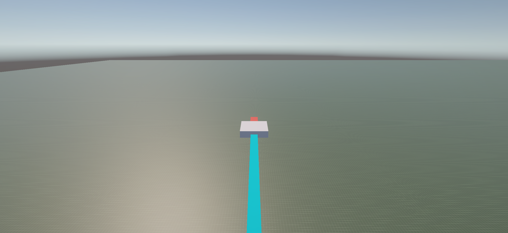
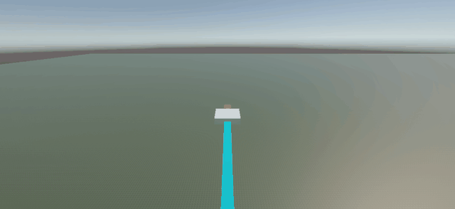
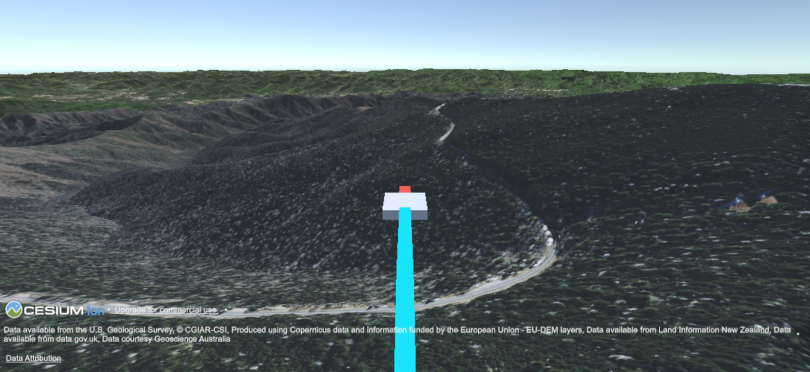
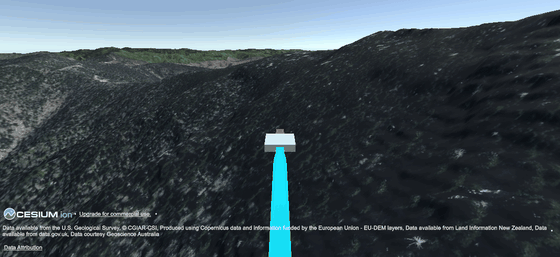
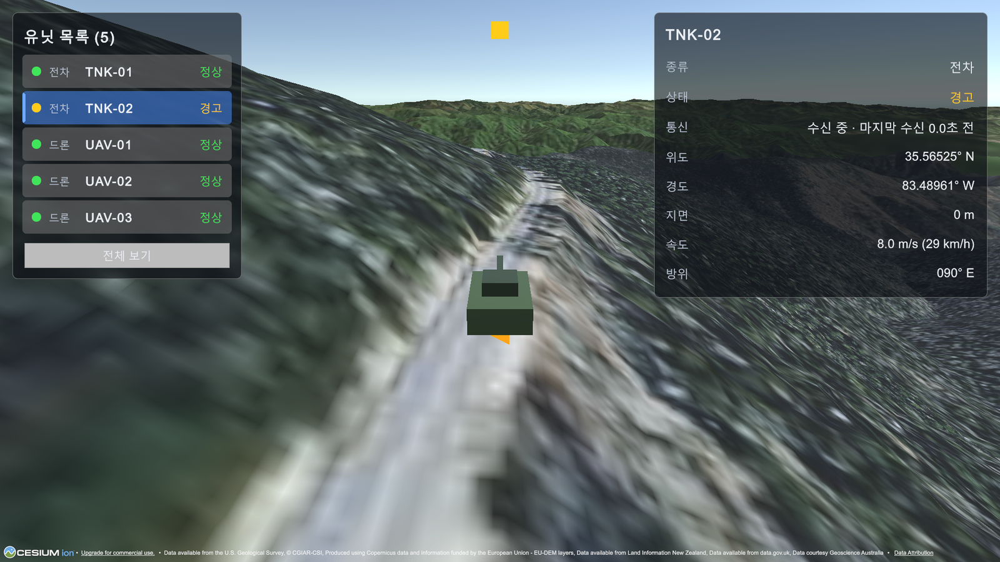
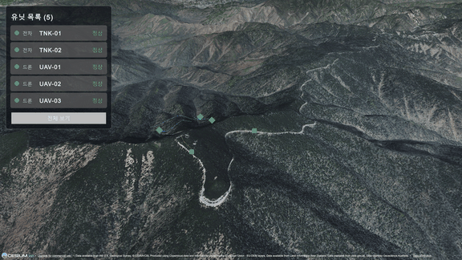
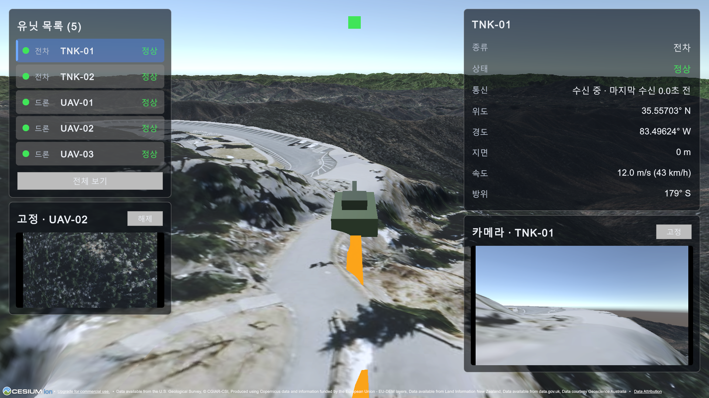
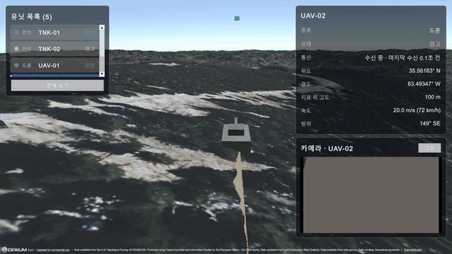
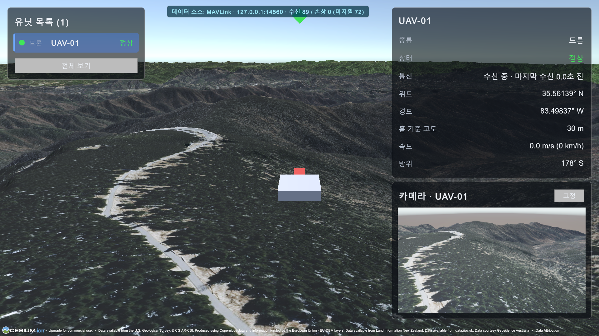
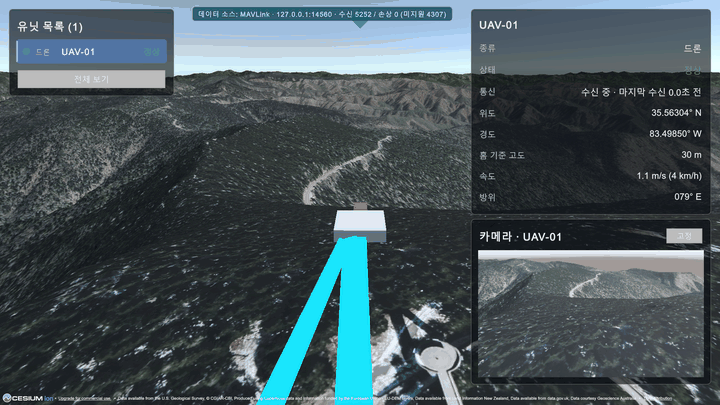

# DroneC2 개발 일지

## 1단계 — 평면 위 가짜 GPS 드론 이동·경로 표시

- 기간: 2026-10-10 – 2026-10-11
- 태그: `stage-1`
- 환경: Unity `6000.6.5f1`, URP 17.6.0, Input System 1.20.0, UnityMCP(MCP for Unity)

*추적 카메라 시점. 드론(회색 본체, 빨간 앞부분)이 진행 방향을 향하고, 하늘색 경로선이 뒤로 이어진다.*

*Play 모드 15초 녹화. 드론이 동쪽 구간 끝 모서리에서 남쪽으로 방향을 틀고 경로선이 이어진다.*

### 목표

가짜 GPS 데이터로 드론 한 대가 넓은 평면 위를 움직이고, 방위각대로 회전하며, 지나간 경로가 선으로 그려지고, 카메라가 드론을 따라가는 것.
데이터 소스와 좌표 변환은 인터페이스로 분리해 이후 MAVLink(5단계)와 Cesium(2단계)으로 구현체만 교체할 수 있게 한다.

### 구현 내용

데이터 소스 → 좌표 변환 → 표시의 3계층을 인터페이스로 분리했다. 표시 계층은 위경도와 데이터 소스 타입을 참조하지 않는다.

| 계층 | 구성 요소 | 내용 |
|---|---|---|
| 데이터 소스 | `TelemetrySample`, `ITelemetrySource`, `FakeGpsSource` | 위경도·고도·방위·속도 샘플을 이벤트로 푸시. 웨이포인트를 속도 25m/s로 순환하며 10Hz로 발행 |
| 좌표 변환 | `ICoordinateConverter`, `LocalTangentPlaneConverter` | 기준점 주변을 평면(ENU)으로 근사. x=동, y=고도, z=북, 방위는 북 기준 시계방향 |
| 표시 | `DroneView`, `PathTrail`, `FollowCamera` | 위치 `SmoothDamp`·회전 `Slerp` 보간, `LineRenderer` 경로선, 뒤·위 추적 카메라 |
| 연결 | `UnitTelemetryBinder` | 소스 → 변환기 → 뷰를 연결하는 유일한 지점 |

- 기준점은 실제 시설과 무관한 공해상 좌표(30.0°N, 40.0°W)이다. 2단계에서 시연용 민간 지역을 따로 정한다.
- Unity는 인터페이스 필드를 직렬화하지 못해, 바인더는 `MonoBehaviour` 필드로 받고 `OnValidate`에서 인터페이스 구현 여부를 검사한다.
- 런타임 어셈블리(`DroneC2.Runtime`)와 EditMode 테스트 어셈블리를 분리했다.
- 5단계 MAVLink 수신은 별도 스레드일 수 있으므로 메인 스레드 전달이 필요하다는 점을 `architecture.md`에 기록했다. (구현은 5단계)

### 검증

| 항목 | 결과 |
|---|---|
| EditMode 테스트 | 7건 통과 (기준점→원점, 위도·경도 오프셋 거리, 고도, 방위 0°/90°/180°) |
| 이동 | 웨이포인트 사각 경로(약 670m × 670m)를 속도 25m/s로 순환 |
| 회전 | 드론 방위 179.57°와 경로선 진행 방향 179.57°가 일치 |
| 경로선 | 2m 간격으로 점 추가, 최대 2000점 |
| 카메라 | 드론과 약 60m 거리를 유지하며 추적 |
| 콘솔 | 오류·경고 없음 |

### 겪은 문제와 해결

**1. 도메인 리로드 후 instance ID가 바뀜**
- **문제:** 스크립트를 추가해 컴파일된 뒤, 이전에 조회해 둔 오브젝트의 instance ID로 접근하면 "찾을 수 없음" 오류가 났다.
- **원인:** Unity는 instance ID가 도메인 리로드나 씬 재로드 이후에도 유지된다고 보장하지 않는다.
- **해결:** ID를 캐시해 재사용하지 않고 컴파일 직후 이름·경로로 다시 조회하도록 순서를 바꿨다. 컴포넌트 간 연결은 직렬화된 참조 필드로 한다.
- **배운 점:** instance ID는 실행 중에만 쓰는 임시 핸들이지 영구 식별자가 아니다. 유지해야 하는 연결은 직렬화 참조나 이름·경로·GUID로 잡는다.

**2. 추적 카메라 평활화 지연**
- **문제:** 카메라 offset을 18m로 줄였는데 이동 중 실측 거리는 약 24m였다.
- **원인:** `SmoothDamp` 평활화 때문에 목표를 늦게 따라간다. 지연 거리는 평활 시간 × 속도(0.25초 × 25m/s ≈ 6m)이다.
- **해결:** 평활 시간을 0.15초로 줄이고, 코너에서 카메라가 휙 돌지 않도록 카메라 방위(yaw)는 별도로 보간했다.
- **배운 점:** 부드러움과 추종 정확도는 트레이드오프다. 평활 시간이 같아도 유닛 속도가 빠를수록 지연 거리가 커지므로, 속도를 기준으로 값을 정해야 한다.

**3. 데이터와 표현의 분리**
- **문제:** 관제 화면에서 실제 크기(2m)의 드론이 너무 작아 식별하기 어려웠다.
- **원인:** 관제 화면은 유닛을 실제보다 크게 표시하는 경우가 많다. 그런데 루트 스케일을 키우면 위치·회전 데이터를 담은 오브젝트에 표시 설정이 섞이고 자식 전체의 스케일도 함께 바뀐다.
- **해결:** `Drone` 루트(위치·회전 데이터)는 스케일 1을 유지하고 시각 요소인 `Body`, `Nose` 자식만 4배로 키웠다. 이후 카메라 offset과 경로선 굵기를 다시 맞추고 스크립트 기본값에도 반영했다.
- **배운 점:** 위치 데이터와 시각 요소를 분리해 두면 표시 크기나 모델을 바꿔도 좌표 계산에 영향이 없다.

### 작업 단위와 커밋

| 단위 | 내용 | 커밋 |
|---|---|---|
| 1 | 스캐폴딩(인터페이스, asmdef) | `5c49508` |
| 2 | `LocalTangentPlaneConverter` + 테스트 | `353c0ff` |
| 3 | 씬 환경(평면, 드론 플레이스홀더) | `8929f19` |
| 4 | `FakeGpsSource`, `DroneView`, `UnitTelemetryBinder` | `2c6a8e4` |
| 5 | `PathTrail` | `38500a4` |
| 6 | `FollowCamera` | `a5e5ddb` |
| 튜닝 | 카메라·경로선 값 조정, 드론 표시 확대 | `b328475`, `fb987ee` |
| 7 | 마무리: Run In Background, 문서 갱신 | `b14633d` (`stage-1` 태그) |

### 남은 과제

- FR-004: 시나리오 JSON 로딩은 미구현. 현재 웨이포인트는 인스펙터에서 입력한다.
- 2단계: Cesium 실제 지형 연동. `ICoordinateConverter` 구현체를 추가하고, 시연용 민간 지역 기준점을 정한다.

## 2단계 — Cesium 실제 지형

- 기간: 2026-10-12
- 태그: `stage-2`
- 환경: Unity `6000.6.5f1`, URP 17.6.0, Cesium for Unity 1.26.0, Cesium World Terrain + Bing Maps Aerial, UnityMCP(MCP for Unity)

*클링맨스 돔 부근 지형 위의 드론. 하늘색 경로선이 뒤로 이어지고, 화면 아래에 Cesium ion·데이터 출처 크레딧을 유지했다.*

*Play 모드 18초 녹화(게임 시간 41–59초, 5fps). 드론이 코너에서 방향을 튼 뒤 능선을 넘으며 지형을 따라 오르내린다. 이 구간의 지형 고저차는 약 120m이고 드론은 지표 위 80m를 유지한다.*

### 목표

1단계의 가짜 GPS 드론을 평면이 아닌 실제 지형 위로 옮긴다. 위경도 기준으로 정확한 위치에 표시하고(FR-006), 지형 고도에 맞춰 높이를 보정한다(FR-007).
표시·데이터 소스 계층은 수정하지 않고 좌표 변환 계층의 구현체만 추가하는 것이 설계 목표다.

### 구현 내용

| 계층 | 구성 요소 | 내용 |
|---|---|---|
| 좌표 변환 | `CesiumGeoreferenceConverter` | WGS84 위경도·타원체고 → ECEF → 지오레퍼런스 기준 Unity 월드 좌표. `ICoordinateConverter`와 `ITerrainHeightSampler` 구현 |
| 좌표 변환 | `ITerrainHeightSampler`, `TerrainHeightGrid` | 지표 높이 조회 인터페이스, 격자 캐시·쌍선형 보간(엔진 비의존 순수 로직) |
| 연결 | `UnitTelemetryBinder`, `AltitudeMode`, `AltitudeResolver` | `Absolute`/`AboveGround`/`ClampToGround` 모드별 최종 고도 계산 |
| 표시 | `DroneView.HasTarget` | 첫 배치 여부 노출(경로선이 배치 전 위치를 기록하지 않게 함) |

- 시연 지역은 그레이트 스모키 산맥 국립공원(미국)이다. 기준점은 35.563°N, 83.499°W(클링맨스 돔 부근), 지오레퍼런스 높이 2000m(타원체고)이며 같은 지점 지형 높이는 1991.8m로 실측했다.
- 경로는 기준점 주변 약 1.2km 사각형(코너까지 약 850m)을 25m/s로 도는 약 192초 순환이다. 드론은 `AboveGround` 80m이다.
- `Stage2Cesium` 씬을 새로 만들어 `SampleScene`(1단계)을 회귀 확인용으로 보존했다.
- 지형·이미지는 Cesium ion 토큰으로 받는다. 토큰은 `assets:read` 권한과 필요한 에셋으로 제한한 전용 토큰이며 저장소에 포함하지 않는다.

### 검증

| 항목 | 결과 |
|---|---|
| EditMode 테스트 | 35건 통과 (변환기 7건 × 2종, 격자 11건, 고도 해석 8건, `DroneView` 2건) |
| 지표 위 높이 | 140점 실측(목표 80m): 최소 77.2 / 최대 81.0 / 평균 79.9m. 구간 지형 높이 1,662–1,921m |
| 수평 속도 | 평균 24.9m/s(명령 25m/s) |
| 코너 | NW·NE 코너에서 방위 90° 회전을 기록, 한 바퀴(약 192초) 순환 |
| 경로선 | 첫 점이 시작 코너이고 점 간 최대 간격 2.2m (수정 전에는 원점에서 926m 직선) |
| 프레임 | 약 21초·12,000프레임에서 30fps 미만 0건, 최대 17ms (에디터 환경) |
| 콘솔 | error·warning 없음 |
| 보안 검사 | 푸시 대상 커밋과 씬에서 토큰 형태 문자열 0건, Cesium 설정 경로 0건 |

### 겪은 문제와 해결

**1. View·DataSource 코드 수정 없이 변환기를 교체했다**
- **과제:** 좌표 변환을 평면 근사에서 Cesium 지오레퍼런스로 바꾸되 표시·데이터 소스 계층은 건드리지 않는다.
- **접근:** 1단계에서 둔 `ICoordinateConverter` 뒤에 `CesiumGeoreferenceConverter`를 구현하고, `UnitTelemetryBinder`의 변환기 참조만 인스펙터에서 바꿨다. 두 변환기에 같은 항목(원점, 위도·경도 오프셋, 높이, 방위 0°/90°/180°)을 검증하는 테스트를 7건씩, 모두 14건 작성했다. Cesium 쪽 기대값은 WGS84 곡률 반경 공식으로 독립 계산해 변환기를 자기 자신과 비교하지 않게 했다.
- **결과:** 변환기 교체 시점(`93e5bdc`)까지 `View`·`Core`·`DataSource` 코드 변경은 0줄이었다. 이후 변경은 고도 모드와 `HasTarget`뿐이다.
- **배운 점:** 인터페이스 경계는 구현을 바꿀 때 비로소 검증된다. 다만 두 변환기의 테스트는 공유 픽스처가 아니라 복제본이라, 계약을 한 곳에서 강제하려면 공통 테스트 베이스가 필요하다.

**2. 토큰 유출 경로를 발견하고 대응했다**
- **문제:** Cesium ion 토큰이 저장되는 파일이 두 곳(`ion.cesium.com.asset`, `CesiumRuntimeSettings.asset`)이었는데 한 곳만 `.gitignore` 대상이었다. 또 토큰 연결 뒤 에디터 콘솔 조회 결과에 토큰이 그대로 나타났다. Cesium 네이티브 라이브러리가 토큰 갱신 URL을 `info` 로그에 쿼리 문자열째 출력하기 때문이며, 그 값이 작업 대화에 노출됐다.
- **대응:** 두 파일과 `Assets/CesiumSettings*` 전체를 무시 처리했다. 노출된 토큰은 교체(재발급)하고 다시 연결했다. 콘솔은 `error`·`warning`만 조회하는 규칙을 문서화했고, 씬의 `ionAccessToken` override 필드는 비워 토큰이 씬에 직렬화되지 않게 했다. 푸시 전에는 올라갈 커밋에서 JWT 형태 문자열과 설정 경로를 검사했고 0건이었다.
- **피해 범위:** 토큰이 `assets:read` 전용이고 선택한 에셋으로만 제한돼 있어 노출 범위가 작았다.
- **배운 점:** 값을 직접 읽지 않아도 도구의 로그가 값을 실어 나를 수 있다. 비밀 값은 저장소뿐 아니라 로그·대화 경로까지 점검해야 하고, 최소 권한 토큰이 사고 범위를 제한한다.

**3. 스파이크로 확인한 지형 높이 조회와 격자 캐시·보간·비동기 배치**
- **문제:** 해발 약 2,000m 지형에서 고도 50m를 그대로 쓰면 드론이 지형 속에 들어간다. 고도 기준을 지표로 바꾸려면 지형 높이를 조회해야 한다.
- **스파이크:** 설치한 Cesium 1.26.0에서 `Cesium3DTileset.SampleHeightMostDetailed`(비동기)가 있음을 API 목록으로 확인하고, 경로 주변 9점을 조회해 지형이 약 1,556–1,992m임을 실측했다. 콜라이더 레이캐스트는 필요하지 않았다.
- **설계:** 샘플마다 비동기 조회를 보내지 않고 격자 노드(0.0002°, 약 20m) 높이를 캐시해 쌍선형으로 보간한다. 없는 노드는 한 프레임에 모아 한 번에 하나씩 배치 요청하고, 이동 방향으로 2노드를 선읽기한다. 값이 없으면 마지막 유효 값을 쓰고 처음부터 없으면 그 샘플은 건너뛴다. 캐시·보간(`TerrainHeightGrid`)과 모드별 고도 계산(`AltitudeResolver`)은 엔진 비의존 순수 로직으로 분리해 EditMode에서 검증했다.
- **결과:** 지형 고저차가 큰 구간에서도 지표 위 높이가 77.2–81.0m(목표 80m)로 유지됐다.
- **부수 발견:** "값이 없으면 건너뛴다"는 정책 때문에 `PathTrail`이 배치 전 초기 위치를 첫 점으로 기록해 원점에서 시작 코너까지 926m 직선이 그려졌다. Play 검증에서 발견해 `DroneView.HasTarget`으로 수정했다.
- **배운 점:** 비동기 외부 데이터에 의존하는 값은 "아직 없음"을 값의 한 상태로 모델링해야 한다. 그 상태가 다른 컴포넌트(경로선)에 번지는 영향은 실제로 돌려 봐야 드러난다.

### 알려진 한계

- **지연 미측정:** 지형 높이 조회 요청의 응답 지연을 측정하지 못했다. 최초 조회 지연은 로그에만 남고 토큰 노출 방지를 위해 `info` 로그를 읽지 않아 확인하지 못했다. 빠르게 이동하는 유닛이나 타일 미로드 지역에서는 높이가 뒤처질 수 있다.
- **캐시 상한 없음:** 지표 높이 캐시가 무제한으로 쌓인다. 수 km 시연 범위에서는 수천 노드 수준이지만 장거리 운용에는 정리 정책이 필요하다.
- **타원체 높이와 해발 고도의 차이:** 높이는 WGS84 타원체고다. 해발 고도(지오이드 기준)와 달라 이 지역에서 약 30m 차이가 난다(기준점 지형 1991.8m는 타원체고, 공개 자료의 해발은 약 2,025m).
- **원점에서 멀어질 때의 곡률 오차:** `HeadingToRotation`은 위치를 받지 않아 원점 기준 ENU 회전을 쓴다. 원점에서 5km 떨어지면 약 0.05°의 기울기 오차가 생긴다. 시연 범위(약 1km)에서는 무시할 수 있다.

### 작업 단위와 커밋

| 단위 | 내용 | 커밋 |
|---|---|---|
| 0–1 | 호환성 확인, Cesium 패키지 설치 | `b8de9db` |
| 2 | 토큰 연결(사용자 직접), 토큰 파일 무시 처리 | `2e6971f`, `435f300` |
| — | 경로선 재질 누락 수정(Edit 모드 마젠타) | `55a4ab2` |
| 3 | `Stage2Cesium` 씬: 지형·이미지 오버레이 | `9f771eb` |
| 4 | `CesiumGeoreferenceConverter` + 테스트 | `a349805` |
| 5 | 드론 파이프라인을 Cesium 지형 위로 이동 | `93e5bdc` |
| 6 | 지형 높이 조회 스파이크 | (코드 변경 없음) |
| 7 | 지표 기준 고도, 격자 캐시·보간, 고도 모드 | `411b52b` |
| 8 | Play 검증, 경로선 첫 점 수정 | `182f3a4` |
| 9 | 문서 갱신, devlog, README, `stage-2` 태그 | `66e9d86` 외 |

### 남은 과제

- FR-004: 시나리오 JSON 로딩은 여전히 미구현. 웨이포인트는 인스펙터에서 입력한다.
- 3단계: 다중 유닛(드론·전차)과 관제 UI. 전차는 `ClampToGround`로 지형에 붙인다.

## 3단계 — 다중 유닛 + 관제 UI

- 기간: 2026-10-12
- 태그: `stage-3`
- 환경: Unity `6000.6.5f1`, URP 17.6.0, UI Toolkit(런타임), Cesium for Unity 1.26.0, UnityMCP(MCP for Unity)

*TNK-02를 선택한 화면. 목록과 상세 패널, 3D 마커가 모두 경고(노랑)로 바뀌었고 카메라가 도로 위 전차를 추적한다.*

*Play 모드 15초 녹화(게임 시간 28–43초, 5fps). 전체 보기 → UAV-01 추적 → TNK-02 추적(경고 진입) → UAV-02 선택 → 전체 보기. 마지막 장면에서 두 유닛이 경고 색으로 표시된다.*

### 목표

드론 1기였던 파이프라인을 드론 3기·전차 2기로 늘리고(FR-008), 목록에서 선택해 카메라로 포커스하며(FR-009), 선택한 유닛의 위치·고도·속도·방위·통신 상태를 보여 준다(FR-010).
종류와 상태는 아이콘 형태·색상으로 구분한다(FR-011). 표시 계층이 데이터 소스를 모른다는 원칙은 유지한다.

### 구현 내용

| 계층 | 구성 요소 | 내용 |
|---|---|---|
| 데이터 소스 | `UnitKind`, `UnitStatus`, `TelemetrySample` | 종류·상태를 샘플에 실음(기존 호출 호환). `FakeGpsSource`에 시연용 결함 주입(경고 구간, 송신 중단 구간) |
| 연결 | `UnitStateStore`, `UnitRegistry`, `CameraSelectionBinder` | 수신·두절 판정·선택을 담는 순수 로직 저장소, 시계·Transform 조회를 맡는 MonoBehaviour, 선택 → 카메라 연결 |
| 표시 | `UnitMarker`, `FollowCamera.SetTarget` | 종류=마름모/사각형, 상태=초록/노랑/빨강 빌보드 마커, 대상이 없으면 전체 보기 |
| UI | `UnitListPresenter`, `UnitDetailPresenter`, `UnitFormat` | UI Toolkit 목록·상세 패널. 표시 문자열은 엔진 비의존 순수 함수 |

- 유닛은 `Drone.prefab`/`Tank.prefab`으로 만들고, 변환기·레지스트리는 씬에 하나씩 두어 모든 유닛이 공유한다(지형 높이 캐시도 공유). 씬은 `Stage3Control`이며 2단계 씬은 건드리지 않았다.
- 시연 구성: UAV-01–03(지표 위 80/100/60m), TNK-01–02(`ClampToGround`). 모든 식별자와 경로는 가상 값이다.
- 상세 패널의 고도 항목은 고도 모드에 맞춰 이름이 바뀐다: 지표 위 고도 / 지면 / 타원체 고도(WGS84).
- UI는 1920×1080 기준 높이 맞춤 스케일링이다.

### 검증

| 항목 | 결과 |
|---|---|
| EditMode 테스트 | 65건 통과 (기존 35 + 상태 저장소 13 + 표시 포매터 17) |
| 지표 위 높이 | 드론 59.9–100.4m(목표 60/80/100m), 전차 -0.1–0.1m (Play, 5기 동시 이동) |
| 상태 전이 | 설정 시각과 일치: TNK-02 경고 30.1→55.0초, UAV-02 경고 40.1→60.1초, UAV-03 두절 62.0→복구 68.0초(송신 중단 60–68초, 두절 판정 2초) |
| UI 표시 | 경고·두절 구간에서 목록 점·라벨, 상세 패널, 3D 마커 색이 함께 바뀜. 두절 시 `두절 · 마지막 수신 3.5초 전` |
| 성능(NFR-001) | 에디터·Game 뷰 1101×506·vSync 끔 기준 5기 평균 657 FPS(1.5ms), 10기 평균 643 FPS(1.6ms). 각 약 22–23초 구간 평균 |
| 높이 캐시 | 5기 869노드(약 26초) → 10기 2,222노드(약 1분 15초). 상한 없음 |
| 직접 확인 | 에디터에서 목록 클릭 선택, 카메라 전환, 전체 보기 버튼 동작을 사용자가 확인 |
| 콘솔 | error·warning 없음(에디터 WebSocket 일시 경고 제외) |
| 보안 검사 | 푸시 대상 8개 커밋에서 토큰 형태 문자열 0건, Cesium 설정 경로 0건 |

### 겪은 문제와 해결

**1. 두절을 누가 판정하는가 — 소스가 아니라 수신 측**
- **문제:** 유닛 상태에 "두절"을 넣어야 하는데, 소스가 `Lost`를 보내게 하면 통신이 끊긴 상황을 표현할 수 없다. 끊기면 아무것도 오지 않기 때문이다.
- **결정:** 소스는 Normal/Warning만 보고하고, 마지막 샘플 이후 2초가 지나면 `UnitStateStore`가 Lost로 표시한다. `FakeGpsSource`의 송신 중단 구간은 샘플을 아예 보내지 않는 방식으로 이를 시험한다. 종류·상태 enum은 `TelemetrySample`과 같은 DataSource 계층에 두어 데이터 소스가 Core를 참조하지 않게 했다.
- **남긴 숙제:** 소스용(Normal/Warning)과 표시용(+Lost)을 타입으로 나눠 두절 보고를 컴파일 단계에서 막을지는 MAVLink 수신(5단계)에서 결정한다.
- **배운 점:** "없음"을 상태로 표현해야 하는 값은 보내는 쪽이 아니라 받는 쪽이 시간으로 판정해야 한다.

**2. 전차 경로를 경사 분석으로 골랐지만 지형이 기준보다 가팔랐다**
- **과제:** 전차는 지형에 붙어 달리므로 급경사를 가로지르는 경로는 부자연스럽다. 도로나 완만한 지형을 따라 경로를 잡고 경사를 검증하기로 했다.
- **접근:** 경로 주변 10,201점(25m 간격)의 지형 높이를 받아 경사를 계산하고, 위성 영상에서 눈대중으로 읽은 도로 안내선 주변 회랑에서 가장 완만한 경로를 탐색했다. 분석은 일회성 스크립트로 하고 저장소에는 남기지 않았다.
- **결과:** 안내선 그대로는 최대 29°였고, 탐색 후 TNK-01은 최대 15.0°(10m 보간, 25m 기준 12.2°), 도로 직선 구간의 TNK-02는 9.2°였다. 도로 동쪽 연장 구간은 기준(15°)을 맞추지 못했고(약 16–19°), 도로 밖에서 찾은 가장 완만한 경로도 최대 경사가 22°여서 기준(15°)을 넘었다(이 지역 분석 범위 안에서).
- **판단:** 안내선이 영상 눈대중이라 TNK-01은 도로에서 벗어나 숲을 달리는 구간이 있다. 전차는 야지 주행도 하므로 도로 보정은 하지 않고 알려진 한계로 남겼다. TNK-02 경로는 약 0.7km로 짧다.
- **배운 점:** 목표 수치를 먼저 정하고 측정하면 "이 지형에서는 못 맞춘다"는 사실이 숫자로 남는다. 기준을 낮추기 전에 어느 구간이 왜 넘는지 먼저 확인할 수 있었다.

**3. UI·카메라가 소스를 모르게 하는 구조와, 입력 검증의 한계**
- **구조:** UI와 카메라는 `UnitRegistry`(읽기 모델)만 본다. 목록 클릭, 3D 마커 강조, 카메라 추적이 모두 `UnitStateStore.Select` 한 경로를 타서 선택 상태가 한 곳에만 있다. 상태 저장소와 표시 문자열을 엔진 비의존 순수 로직으로 분리해 EditMode에서 30건을 검증했다.
- **검증의 한계:** 에디터가 포커스를 잃은 상태에서는 Input System이 입력을 Game 뷰로 넘기지 않아 가상 마우스 클릭이 도착하지 않았다. 대신 UI 요소에 클릭 이벤트를 직접 보내 핸들러 → 선택 → 카메라 경로를 검증하고, 실제 마우스 입력과 Esc 키 해제는 사용자가 에디터에서 직접 Play로 확인했다.
- **배운 점:** 자동 검증이 닿지 않는 경계(실제 입력)는 어디까지 확인했는지를 구분해 적어 둬야 한다. 이벤트를 직접 주입한 검증은 입력 장치 경로를 증명하지 않는다.

### 알려진 한계

- **TNK-01 경로가 도로에서 벗어남:** 도로 안내선이 영상 눈대중이라 구간에 따라 도로 옆 숲을 달린다. 야지 주행을 허용하는 시나리오로 보고 보정하지 않았다.
- **전차 경로 길이·경사:** TNK-02는 약 0.7km로 짧다. TNK-01의 최대 경사는 15.0°로 기준에 딱 걸린다. 전차의 기울기는 지형 경사를 따르지 않고 높이만 지면에 붙는다.
- **고도 값의 의미:** 상세 패널의 고도는 샘플이 보고한 값 그대로다. 모드별 이름만 바뀌며, `Absolute` 값은 WGS84 타원체고라 해발 고도(지오이드 기준)와 이 지역에서 약 30m 차이가 난다.
- **높이 캐시 상한 없음:** 10기·약 1분 15초에 2,222노드. 장시간·다수 운용에는 정리 정책이 필요하다.
- **카메라 전환 중 지형 품질:** 선택을 바꿔 카메라가 빠르게 이동하는 동안 Cesium 타일이 덜 로드되어 지형이 잠깐 갈색·거칠게 보인다(GIF 중간 장면). 전환 시간을 늘리거나 타일 선읽기를 조정하는 것은 하지 않았다.
- **3D 오브젝트 클릭 선택 미구현:** 선택은 목록과 Esc/전체 보기 버튼으로만 한다.
- **성능 수치의 범위:** 에디터에서 작은 Game 뷰로 잰 값이며 빌드 측정이 아니다. 60 FPS 목표 대비 여유가 크다는 정도로만 읽는다.
- **시나리오 JSON 미구현:** FR-004는 4단계로 이월했다. 웨이포인트는 인스펙터에서 입력한다.

### 작업 단위와 커밋

| 단위 | 내용 | 커밋 |
|---|---|---|
| 3-A | `UnitKind`/`UnitStatus`, `UnitStateStore`/`UnitRegistry`, 결함 주입 + 테스트 | `5842427` |
| 3-B | `Stage3Control` 씬, 드론·전차 프리팹과 경로 5기 | `9a90b83` |
| 3-C | `UnitMarker`, `CameraSelectionBinder`, 카메라 대상 교체·전체 보기 | `878270c` |
| 3-D | `UnitFormat`, UI Toolkit 목록·상세 패널 | `83ebd54`, `b71797a`, `3a079ee` |
| 3-D 보정 | UI 크기(1920×1080 기준), 고도 라벨, 폭·줄바꿈 | `9bd3504`, `02f8484` |
| 3-F | 성능 측정, 문서 갱신, `stage-3` 태그 | (이 커밋) |

### 남은 과제

- FR-004: 시나리오 JSON 로딩은 4단계로 이월. 다중 유닛 시나리오를 한 파일로 재현하려면 필요하다.
- 4단계: 선택한 유닛의 카메라 패널.
- 5단계: `UnitStatus` 소스용/표시용 분리 재검토, MAVLink 수신 시 메인 스레드 전달.

## 4단계 — 카메라 패널

- 기간: 2026-10-13 – 2026-10-14
- 태그: `stage-4`
- 환경: Unity `6000.6.5f1`, URP 17.6.0, UI Toolkit(런타임), Cesium for Unity 1.26.0, UnityMCP(MCP for Unity)

*TNK-01을 선택하고 UAV-02를 고정한 화면. 오른쪽 아래가 선택한 유닛(전차, 차체 전방), 왼쪽 아래가 고정한 유닛(드론, 직하방)의 가상 카메라 영상이다.*

*Play 모드 15초 녹화(10fps, 실제 약 24초 분량을 15초로 재생). UAV-02 선택 → 고정 → TNK-01 선택. 고정 패널은 선택과 별개로 유지된다.*

### 목표

선택한 유닛의 카메라 영상을 패널에 표시하고(FR-012), 패널을 최대 2개까지 두어 선택 유닛과 고정 유닛을 함께 본다(FR-013).
3단계에서 이월한 시나리오 JSON 로딩(FR-004)도 포함한다. 영상은 샘플 영상이 아니라 가상 카메라(RenderTexture)로 하며, 패널은 다른 UI와 마찬가지로 레지스트리만 읽는다.

### 구현 내용

| 계층 | 구성 요소 | 내용 |
|---|---|---|
| 표시 | `UnitCameraRig` | 유닛 프리팹의 자식 카메라 + `RenderTexture`(640×360). 평소엔 렌더하지 않고 `SetRendering`으로 켠 동안만 그린다. 드론은 기수 앞 30° 하향(처음엔 직하방), 전차는 차체 전방 |
| 표시 | `CesiumUnitCameraLink` | 렌더 중인 유닛 카메라만 Cesium 타일 선택 카메라(`additionalCameras`)에 등록·해제 |
| 연결 | `UnitCameraPolicy`, `UnitTelemetryBinder` | "선택되었거나 고정되었고 두절이 아니면 렌더" 규칙(순수 함수). 바인더가 선택·고정·상태 변화마다 적용 |
| 연결 | `UnitStateStore.Pin/Unpin`, `UnitRegistry.TryGetCameraTexture` | 고정 상태(최대 1기, 선택과 독립)와 유닛별 영상 텍스처 조회 |
| UI | `CameraPanelPresenter` | 선택 패널(오른쪽, 상세 아래)과 고정 패널(왼쪽, 목록 아래). `고정`/`해제` 버튼, 두절 시 "신호 없음" 오버레이 |
| 데이터 소스 | `Scenario`, `FakeGpsSource.scenarioJson` | 경로·고도·속도·종류·결함 구간을 JSON으로 읽고 검증. `Assets/Scenarios/stage3-demo.json`은 3단계 5기를 그대로 옮긴 것 |
| 도구 | `PerfProbe` | 프레임 시간·활성 타일 렌더러 수를 샘플링하는 개발용 측정기(에디터 전용) |

- 전차 카메라는 차체 앞면 바로 앞(차체 기준 높이 2m, 전방 6.3m)에 둔다. 처음 둔 위치에서는 모델의 포신이 영상 위쪽에 걸려 시야를 가려서 옮겼다. 무기 관련 기능은 범위 밖이며, 카메라는 차체 전방만 향한다.
- UI는 1920×1080 기준에서 두 열이 모두 들어가도록 고정 패널을 왼쪽 목록 아래에 두었다(오른쪽 아래 끝 1010px).
- 시나리오 JSON은 위경도·고도·속도만 담고 고도 모드는 담지 않는다. 고도 모드는 3단계처럼 바인더 설정이다.

### 검증

| 항목 | 결과 |
|---|---|
| EditMode 테스트 | 88건 통과 (기존 65 + 카메라 규칙 5 + 고정 5 + 시나리오 13) |
| 선택 전용 렌더 | 선택 없음 0기, 선택 1기, 고정+선택 2기, 선택 해제(고정 유지) 1기, 고정 해제 0기로 렌더 중인 카메라 수가 일치 |
| 패널 연동 | 선택·해제·고정·교체 때 패널 표시, 제목, 버튼 활성(같은 유닛 중복 고정 불가)이 기대대로 바뀜 |
| 영상 | 선택 유닛 영상 픽셀이 단색이 아님(드론·전차). 두 패널 모두 지형 영상 확인(GIF·스크린샷) |
| 시나리오 | 5기 모두 JSON 값으로 구성됨(종류·고도·속도·웨이포인트 수·두절 구간). 3단계와 같은 값을 옮겨 같은 이동을 재현 |
| 콘솔 | 실제 오류 없음. 테스트 실행 중 Play를 시작해 중단된 한 번의 오류와 에디터 WebSocket 일시 경고는 제외 |
| 보안 검사 | 4-C 시점 푸시에서 토큰 형태 문자열 0건, Cesium 설정 경로 0건. 이후 커밋은 푸시 전에 다시 검사 |

### 성능·타일 부담 측정

에디터·Game 뷰 1920×1080·vSync 끔. 각 조건마다 워밍업(8–15초) 후 20초 샘플링, 5기가 이동하는 `Stage3Control`. 빌드 측정이 아니다.

| 조건 | 평균 프레임 | FPS | p95 | 최대 | 활성 타일 렌더러 | 메모리 |
|---|---|---|---|---|---|---|
| A. 유닛 카메라 없음 | 1.51ms | 662 | 1.80ms | 8.9ms | 95 | 1,020MB |
| B. 유닛 카메라 1대, Cesium 미등록 | 1.94ms | 515 | 2.28ms | 9.0ms | 95 | 1,052MB |
| C. 유닛 카메라 2대, Cesium 미등록 | 2.40ms | 416 | 2.86ms | 10.9ms | 95 | 1,076MB |
| D. 1대, Cesium 등록 | 2.15ms | 465 | 2.63ms | 9.3ms | 149 | 1,238MB |
| E. 2대, Cesium 등록 | 3.50ms | 286 | 5.81ms | 262ms | 351 | 1,488MB |

- 카메라 1대의 렌더 비용은 약 0.4ms다. 60 FPS 목표(NFR-001) 대비 여유가 크다.
- 등록하면 카메라 시점에 맞는 타일을 추가로 선택하므로 타일이 늘고(95 → 149 → 351) 메모리도 는다. 2대 등록 직후에는 262ms 정지가 한 번 있었다(타일 로딩 구간).
- "활성 타일 렌더러"는 타일셋 아래 켜진 `MeshRenderer` 수이며 유닛 카메라가 바라보는 위치에 따라 달라진다. 조건 간 비교용 대략치로만 본다. B–E는 각각 한 번씩만 측정했다.

### 겪은 문제와 해결

**1. 유닛 카메라는 메인 카메라가 로드한 타일만 본다**
- **문제:** 처음에는 타일 부담을 줄이려고 유닛 카메라를 Cesium에 등록하지 않았다(조건 B·C). 그러나 메인 카메라가 다른 유닛을 보고 있으면 고정한 드론 카메라 영상이 단색 회갈색으로만 나왔다. 그 위치의 타일이 로드되지 않았기 때문이다.
- **측정:** 등록 여부를 비교하니 1대 기준 활성 타일이 95 → 149(+57%), 평균 프레임 1.94 → 2.15ms였다. 2대에서는 타일 351, 최대 262ms 정지가 있었다.
- **결정:** 선택·고정되어 실제로 렌더 중인 카메라만 Cesium에 등록하고, 렌더가 꺼지면 해제한다(`CesiumUnitCameraLink`). 등록 수가 패널 수(최대 2)로 묶여 타일 부담이 한정된다.
- **배운 점:** 별도 시점을 렌더하는 카메라는 렌더 비용뿐 아니라 그 시점의 데이터(타일) 선택 비용도 낸다. 프레임 시간만 보면 "등록하지 않는 편이 싸다"가 결론이었지만 화면 품질과 함께 봐야 했다.

**2. 카메라가 자기 유닛 모델을 비춘다**
- **문제:** 전차 카메라를 포탑 앞쪽 위에 두자 영상 위쪽에 자기 포신 모델이 걸렸다.
- **해결:** 레이어로 자기 모델만 숨기면 다른 유닛의 같은 부품도 숨는다. 대신 카메라를 차체 앞면 바로 앞 낮은 위치로 옮겨 포신이 시야 위쪽 밖으로 나가게 했다.
- **배운 점:** 가상 카메라 위치는 "무엇이 시야에 들어오는가"의 문제라서 직접 화면으로 확인해야 했다.

**3. 테스트 실행 중 Play를 시작해 테스트가 깨졌다**
- **문제:** 테스트 작업이 끝나기 전에 Play 모드를 시작해 테스트 실행이 중단되고 콘솔에 오류가 쌓였다.
- **해결:** 같은 에디터에서 테스트와 Play를 겹쳐 하지 않고, 테스트 결과를 확인한 뒤 Play를 시작한다. 이후 다시 실행해 88건 통과로 확인했다.

### 직접 확인 후 수정

자동 검증(렌더링 여부, 테스트 88건)은 통과했지만, 직접 화면을 보고 문제를 찾았다. 아래는 직접 Play해서 확인한 결과와 수정이다.

**1. 두절 오버레이는 정상**
- 두절 시 "신호 없음" 오버레이가 나오는 것을 직접 확인했다.

**2. 고정 패널(UAV-03)이 거의 검게 보임: 렌더링 문제가 아니라 비율과 밝기 문제였다**
- **처음 의심:** 고정한 카메라가 렌더링되지 않거나 Cesium에 등록되지 않아 영상이 비었다고 봤다.
- **측정:** 렌더 여부(`IsRendering`)와 Cesium 등록(`additionalCameras`)은 정상이었다. 두절 → 복구 뒤에도 렌더가 재개되고 영상이 갱신됐다. 영상 픽셀을 읽으니 평균 밝기가 약 31이었다(같은 시각 전차 카메라 123).
- **원인:** (1) 영상 폭이 프레임보다 좁아 좌우에 큰 검은 여백이 생겼다(비율). (2) UAV-03이 그림자 쪽 사면의 숲을 직하방으로 보고 있었다(밝기).
- **수정:** 프레임을 16:9에 맞춰 여백을 없앴고(선택 패널 339px, 고정 패널 226px), 드론 카메라를 기수 앞 30° 하향으로 옮겼으며, 유닛 카메라에만 노출 +1.6EV를 적용했다(전용 레이어 `UnitCameraFx`의 URP 볼륨. 메인 카메라는 후처리를 쓰지 않아 영향이 없다).
- **결과:** 평균 밝기가 약 33 → 60이 되어 사면과 숲이 식별된다. 그림자 사면 위에서는 여전히 어둡다. 조명 자체는 바꾸지 않았다.

**3. 유닛 목록 5행이 다 안 보이고 스크롤바가 생김**
- **원인:** 목록 패널의 `max-height: 75%`가 내용에 따라 높이가 정해지는 부모 열 기준이라, 고정 패널이 없을 때 높이가 줄어(512 → 384px) 5행이 다 들어가지 않았다.
- **수정:** 비율 제한을 없애고 행 7개 높이(490px)까지는 스크롤 없이 보이게 했다.
- **확인:** 고정 패널이 있을 때와 없을 때 모두 5행이 스크롤바 없이 표시되는 것을 직접 Play로 확인했다. 스크롤 영역 높이도 함께 측정했다(콘텐츠 350px = 뷰포트 350px, 스크롤바 없음).

**배운 점**
- 추측 대신 수치로 원인을 분리한다. "렌더링이 안 된다"는 의심은 렌더 여부·등록 여부·픽셀 평균을 각각 읽자 바로 갈렸고, 실제 원인은 다른 곳(비율, 밝기)이었다.
- UI·영상 기능은 사람의 시각 확인을 검증 단계에 포함한다. 규칙 테스트와 상태 조회가 모두 통과해도 화면의 어두움, 여백, 잘림은 직접 봐야 드러났다.

### 알려진 한계

- **두절 오버레이 화면 미캡처:** "신호 없음" 오버레이는 두절 판정(`Lost`)에 연결되어 있고 렌더 규칙은 테스트했지만, 두절 순간의 패널 화면은 캡처하지 못했다.
- **버튼 입력 미검증:** `고정`/`해제` 버튼은 저장소 호출(`Pin`/`Unpin`)과 패널 반응으로 확인했고, 실제 마우스 클릭은 에디터 포커스 제약으로 검증하지 못했다.
- **고정은 1기:** 패널 2개(선택 1 + 고정 1)까지다. 여러 유닛을 동시에 고정하지 않는다.
- **카메라 영상은 가상:** 지형 위 가상 카메라이며 실제 센서 영상이 아니다. 해상도는 640×360 고정이다.
- **타일 로딩 중 영상:** 등록 직후 해당 위치 타일이 로드될 때까지 영상이 거칠다. 2대 등록 직후 262ms 정지가 한 번 관측됐다.
- **성능 수치의 범위:** 에디터 측정이며 유닛 5기, 조건당 20초 1회다. 빌드 측정이 아니다.
- **시나리오 JSON 범위:** `FakeGpsSource`가 유닛 id로 항목을 찾아 시작 시점에 한 번 적용한다. 재생 중 교체나 파일 감시는 없다.

### 작업 단위와 커밋

| 단위 | 내용 | 커밋 |
|---|---|---|
| 사전 | CLAUDE.md "남은 할 일"에 공개 전 클론 검증 추가 | `821ec2f` |
| 4-A | `UnitCameraRig`, `UnitCameraPolicy`, 프리팹에 카메라 추가 | `df0a853` |
| 4-B | 레지스트리 텍스처 조회, `CameraPanelPresenter`, UXML/USS | `3375990` |
| 4-C | `PerfProbe` 측정 도구, 성능·타일 측정 | `2cdf4fd` |
| 4-D | 고정 유닛(선택 + 고정, 패널 2개) | `ae987ab` |
| 4-E | 시나리오 JSON(FR-004), `stage3-demo.json` | `ab99b2a` |
| 4-C 보정 | 렌더 중 카메라만 Cesium 등록, 전차 카메라 위치 | `375176e` |
| 4-F | 문서 갱신, `stage-4` 태그 | (이 커밋) |

### 남은 과제

- 5단계: MAVLink 시뮬레이터 텔레메트리 수신, 데이터 소스 전환(FR-014, FR-015). 수신 스레드에서 메인 스레드로 넘기는 큐가 필요하다.
- `UnitStatus` 소스용/표시용 분리 재검토(3단계에서 이월).
- 지표 높이 캐시 상한(2·3단계에서 이월).
- 저장소 공개 전: 새 폴더에 클론해 README 실행 방법대로 동작하는지 확인.

## 5단계 — MAVLink 시뮬레이터 연동

- 기간: 2026-10-14 – 2026-10-25
- 태그: `stage-5`
- 환경: 4단계와 같음 + Mission Planner 1.3.83(ArduPilot SITL, ArduCopter 4.7.2), pymavlink 2.4.50(에미터 전용, 별도 프로세스)

*MAVLink 모드, UAV-01 선택. 상단 표시줄은 `수신 89 / 손상 0 (미지원 72)`, 상세 패널의 고도는 "홈 기준 고도 30m"다. 수신하지 못한 유닛 4기는 목록에도 화면에도 나타나지 않는다.*

*Mission Planner에서 "이곳으로 비행"을 눌러 UAV-01이 약 170m 이동하는 구간(최대 10m/s). 프레임 저장 속도(약 7fps)와 10MB 한도 때문에 3.5fps로 조립했다.*

### 목표

실제 시뮬레이터(ArduPilot SITL)가 내보내는 MAVLink 텔레메트리를 받아 유닛을 움직이고(FR-014), 데이터 소스를 가짜 GPS와 MAVLink 사이에서 설정으로 전환한다(FR-015).
표시 계층과 좌표 변환은 고치지 않고 `ITelemetrySource` 구현체만 더하는 것이 목표였다. 수신·표시 전용이라 유닛으로 명령을 보내는 경로는 만들지 않는다.

### 구현 내용

| 계층 | 구성 요소 | 내용 |
|---|---|---|
| 데이터 소스 | `MavlinkParser`, `MavlinkDecoder` | v1·v2 프레임 파서(CRC·잘린 v2 페이로드 복원·서명 길이 처리), HEARTBEAT·GLOBAL_POSITION_INT 디코더. 외부 라이브러리 없이 규격을 보고 직접 작성 |
| 데이터 소스 | `MavlinkUdpListener`, `MavlinkReceiver` | 루프백 UDP 수신 전용 스레드와 상한 있는 큐, 메인 스레드에서 큐를 비우는 수신기(씬에 하나). 송신 코드 없음 |
| 데이터 소스 | `MavlinkTelemetryRouter`, `MavlinkUnitTable`, `MavlinkUnitSource` | sysid → 유닛 매핑(ScriptableObject 테이블), 상태·방위·고도 의미 결정, sysid별 `ITelemetrySource`. 테이블에 없는 sysid는 무시하고 센다 |
| 데이터 소스 | `ReportedStatus`, `AltitudeMode.HomeRelative` | 소스가 보고하는 상태(Normal/Warning)와 표시용 상태(+Lost)를 분리, 홈 기준 고도 모드 추가 |
| 연결 | `TelemetrySourceSelector` | 시작 시 소스를 전환(FR-015). MAVLink 모드에서만 수신기 소켓을 연다 |
| UI | `DataSourceStatusPresenter` | 상단에 데이터 소스·수신 상태를 항상 표시 |
| 도구 | `tools/mavlink_emitter.py` | 시나리오 5기를 sysid 1~5로 재생하는 가상 에미터(별도 프로세스, 저장소 밖 venv) |

계층 규칙은 유지했다. 수신기는 Coordinate 계층을 모르고(고도의 의미만 샘플에 싣는다), 소스·변환기·뷰는 `UnitTelemetryBinder`에서만 만난다. 표시 코드는 소스 교체 때문에 고치지 않았다.

### 검증

| 항목 | 결과 |
|---|---|
| EditMode 테스트 | **162건 통과** (4단계 88 + 파서·라우터·소스·고도 해석·표시줄·`DroneView`·상태 라벨 74) |
| 에미터 75초 재생(5-E) | 데이터그램 4037(v2 4037 / v1 0 / 거부 0), 위치 샘플 3670. 상태 전이가 시나리오와 일치(경고 구간, UAV-03 두절 62→복구 68초, 송신 종료 2초 뒤 5기 모두 두절) |
| 소스 전환(5-D) | FakeGps 정상, MAVLink 모드 전환 후 합성 프레임으로 UAV-01 이동(HomeRelative 80m), 되돌리면 소켓이 닫히고 유닛 복구 |
| SITL 지상(5-F) | UAV-01 위경도 35.563000 / -83.499000(홈과 일치), HomeRelative, 지표 위 약 −0.01m, MAV_TYPE 불일치 경고 없음 |
| SITL 이륙 | Guided 30m 이륙 후 상대고도 30.00m, 월드 높이가 `홈 지형 + 상대고도`와 0.00m 차이 |
| SITL 이동 | 21.5초간 약 170m 남진(홈에서 188m), 최대 10.25m/s, 방위 176.6°로 이동 방향과 일치, 상대고도 30.00±0.01m 유지. 지표 위 높이는 지형 때문에 27.2~57.6m로 변하며 매 행 기대값과 0.01m 이내. 기록 간격 1.2초 초과 구간 없음 |
| 수신 카운터(SITL) | v1 0 / v2 전부, **손상 0**, 큐 드롭 0, 수신 중 순간 프레임 약 260FPS(에디터, 1회 읽음) |
| 콘솔 | 컴파일 오류 없음. 경고는 기존 `FindObjectsSortMode` 폐기 경고 4건뿐 |
| 보안 검사 | 푸시 전 토큰 형태 문자열과 `Assets/CesiumSettings` 경로 검사(결과는 푸시 보고에 기재) |

높이 검증의 범위: 위의 "기대값과 일치"는 리졸버와 같은 지형 샘플러로 계산한 값이라 렌더된 지형 메시에 대한 독립 검증이 아니다. 독립 검증은 5-E에서 한 번 했다(아래 설계 결정 1).

### 겪은 문제와 해결 · 설계 결정

**1. 고도는 `HomeRelative`로 설계했고, 독립 측정으로 한계까지 확인했다**
- **문제:** MAVLink `GLOBAL_POSITION_INT`의 `alt`는 해수면(MSL) 고도라 지형 기준의 타원체고(2~3단계에서 쓰는 값)와 약 30m 달라서 그대로 쓸 수 없다. 드론은 자기 아래 지형을 모른다.
- **결정:** 드론은 `relative_alt`(홈 기준)만 쓰고, 홈 위경도는 유닛 테이블 설정값으로 둔다. 바인더가 `홈 지형 높이 + relative_alt`를 계산한다. `HOME_POSITION`을 요청하거나 첫 샘플을 홈으로 가정하지 않는다. 우리는 송신하지 않으므로 요청이 불가능하고, 이 방식은 비행 중에 접속해도 정확하다. 라우터는 고도의 "의미"(`AltitudeMode`)만 샘플에 실어 보내고 지형 조회는 바인더가 한다. 이 때문에 고도 기준을 샘플의 필수 인자(`AltitudeReference`)로 옮겼고, 바인더의 직렬화 필드가 없어졌다. 3단계에서 `AltitudeMode`가 바인더 설정이었던 구조를 이 단계에서 바꿨다.
- **검증:** 에미터로 드론을 홈에서 `relative_alt=0`으로 두고, 샘플러(지표 위 0.00m)와 런타임에 켠 물리 메시 레이캐스트(+3.41m)를 비교했다. 12점 조사에서 샘플러와 메시의 차이는 −4.1~+0.3m였다. 격자 보간 오차이며, 격자를 4배 촘촘히 한 실험(TNK-01 평균 |오차| 1.47 → 0.65m)으로도 일부만 줄고 완전히 없어지지 않아 되돌렸다. SITL 실측에서는 위의 표처럼 고도가 홈 지형 기준으로 유지된다.
- **한계:** 지상 유닛은 지형에서 약 ±4m 뜨거나 파묻혀 보일 수 있다(해결안은 6단계 후보).
- **배운 점:** "값이 일치한다"는 검증은 같은 계산을 거친 값끼리면 의미가 약하다. 렌더된 메시를 레이캐스트하는 독립 측정을 한 번 넣었더니 샘플러와 화면 사이의 차이가 드러났다.

**2. Mission Planner Mirror는 실패했고, SITL이 직접 보내게 했다. 스트림 설정 이름 변경과 재시작 필요가 겹쳤다**
- **문제:** Mission Planner의 "MAVLink(직렬 출력)" 표에서 UDP로 `127.0.0.1:14560`을 지정하고 Go를 누르면 "개체 참조가 개체의 인스턴스로 설정되지 않았습니다" 오류가 두 번 나왔다. Mission Planner에는 예외 스택이 남는 텍스트 로그가 없어(텔레메트리 기록만 있음) 원인은 확인하지 못했다.
- **결정:** Mirror를 쓰지 않고 SITL이 Unity로 직접 보내게 했다. Extra command line에 `--serial1=udpclient:127.0.0.1:14560`을 주었다(`ArduCopter.exe --help`에 `--serial1` 옵션이 있음). 수신 전용 원칙은 유지된다. Unity는 어떤 요청도 보내지 않는다.
- **새 문제:** 연결은 됐지만 샘플이 0이었다. 데이터그램은 오는데 위치가 없었다. 라우터까지는 sysid 1이 도달하는데 샘플이 0이라, 두 번 측정(29초 간격)으로 통과 프레임이 약 1개/초(HEARTBEAT뿐)이고 거부는 0.1개/초임을 확인했다. 즉 SITL이 `GLOBAL_POSITION_INT`를 보내지 않았다.
- **원인(사용자 확인):** 4.7.2에서는 스트림 파라미터 이름이 `SRn_*`에서 `MAVn_*`로 바뀌었고 번호가 1부터라 `MAV2`가 SERIAL1이다(`MAV2_POSITION`=4). 그리고 이 설정은 **부팅할 때 적용되므로 쓴 뒤 SITL을 재시작해야** 했다. 재시작하자 위치가 들어오기 시작했다.
- **배운 점:** 수신기 카운터(데이터그램 → 파서 통과 → 라우터 샘플)로 어느 단계에서 끊기는지 먼저 나누니, 코드가 아니라 송신 측 설정 문제임을 바로 가를 수 있었다. 절차는 CLAUDE.md와 README에 남겼다.

**3. 가짜·실제 데이터를 섞지 않는 원칙을 화면과 카운터까지 일관되게 적용했다**
- **가짜로 대체하지 않기:** MAVLink 모드인데 수신기가 없으면 가짜 GPS로 대체하지 않는다. 관제 화면에서 가짜 데이터를 실제처럼 보여 주는 것이 가장 위험하다고 보고, 모드를 유지한 채 오류를 출력해 데이터가 오지 않게 둔다(유닛은 수신 없음으로 남는다).
- **수신 전에는 숨기기:** 한 번도 수신하지 못한 유닛(TNK-01/02 등)의 3D 모델이 씬 초기 위치에 그대로 보여, 목록에는 없는데 화면에만 있었다. `DroneView`가 첫 목표 전에는 모델·마커·경로선 등 자식 렌더러를 모두 끄고 첫 배치 때 켠다. 이미 수신했다가 두절이 된 유닛은 마지막 위치에 남긴다.
- **손상과 미지원을 구분해 보여 주기:** 파서의 거부 카운터가 거부 1846에서 "모르는 메시지"와 "손상 프레임"을 구분하지 못했고, 모르는 메시지를 한 바이트씩 건너뛰어 페이로드 안의 시작 바이트(0xFD/0xFE)를 새 후보로 다시 세는 문제도 있었다(과대 집계 가능성). 그래서 `Unsupported`(해석하지 않는 정상 메시지)와 `Corrupted`(잘림·플래그·길이·CRC)로 나누고, 미지원 메시지는 헤더 길이(v2 서명 13바이트 포함)만큼 통째로 건너뛰게 했다. 상단 표시줄은 `수신 N / 손상 M (미지원 K)`로 바꿔 운용자가 손상 0을 보고 미지원 증가를 오류로 오해하지 않게 했다. 수정 후 SITL 측정에서 손상은 0이었다.
- **한계(알려진 한계):** **소스 전환은 Play 시작 전 설정 기준이다.** Play 중에 모드를 바꾸면 이전 소스가 등록한 유닛이 스토어·목록에 남아 두절로 표시된다. 이는 가짜·실제 데이터를 섞지 않는다는 원칙에 어긋나므로, 6단계 후보 1순위로 "전환 시 스토어·목록 초기화"를 남겼다. **→ 6단계 ①에서 해소했다**(Play 중 전환 시 이전 소스의 유닛·표시·경로선·선택을 모두 비운다). 사용자 직접 확인: Inspector에서 Mode를 바꾸는 전환도 정상이었다. Mavlink로 바꾸면 목록 0기·3D 유닛이 사라지고, FakeGps로 돌리면 5기가 처음부터 다시 나타나며, Play 종료 후 씬은 바뀌지 않았다. 5단계의 스크린샷과 GIF는 편집 모드에서 값을 바꿔(저장하지 않음) Play를 시작하는 방식으로 찍었다.
- **배운 점:** 가짜와 실제를 구분하는 일은 한 곳의 표시가 아니라 소스 선택, 첫 샘플 전 화면, 수신 상태 문구까지 이어지는 일이었다. 화면을 직접 보고서야 수신하지 못한 유닛이 보인다는 문제와 표시줄이 패널과 겹친다는 문제(문구가 길어져 패널 사이 영역으로 옮김)를 찾았다.

### 알려진 한계

- **소스 전환은 Play 시작 전 설정 기준(5단계 당시):** 위 결정 3 참조. 6단계 ①에서 해소했다.
- **지상 유닛 지형 접촉:** 전차(ClampToGround)가 렌더된 지형에서 약 ±4m 뜨거나 파묻혀 보일 수 있다. 샘플러의 높이와 현재 로드된 LOD 메시가 다르기 때문이며 보간 간격으로는 해결되지 않았다(실험 후 되돌림).
- **수신하지 못한 유닛은 목록에 없다:** 저장소가 첫 샘플에서 유닛을 등록하므로, 한 번도 받지 못한 유닛을 두절로 표시하려면 테이블 기반 사전 등록이 필요하다(미구현).
- **SITL 검증 범위:** 드론 1기(sysid 1)만 SITL로 확인했다. 5기 동시 재생은 에미터로 확인했다. 전차(Rover) SITL은 시험하지 않았다. v1 프레임은 단위 테스트와 에미터 옵션(`--mavlink1`)으로만 확인했고 SITL은 v2만 보냈다.
- **지원 메시지:** HEARTBEAT와 GLOBAL_POSITION_INT뿐이다. 그 밖의 메시지는 미지원으로 센다. 미지원으로 판정한 헤더는 CRC를 검증할 수 없어(CRC_EXTRA를 모름) 우연히 형식이 맞는 노이즈가 미지원으로 셀 수 있다.
- **측정 범위:** 에디터 측정이며 빌드 측정이 아니다. SITL 이동은 한 기, 두 번의 이동만 기록했다. GIF는 프레임 저장 속도 때문에 3.5fps다.
- **Mission Planner 설치:** 설치 파일 서명·공식 체크섬이 없어 암호학적 검증을 하지 못했다(아래 설치 기록).

### 작업 단위와 커밋

| 단위 | 내용 | 커밋 |
|---|---|---|
| 5-A | 소스 보고용 `ReportedStatus`와 표시용 `UnitStatus` 분리 | `edbef36` |
| 5-B | MAVLink v1·v2 파서, 디코더, 카운터 | `bc29378` |
| 5-C | UDP 수신기, 라우터, 유닛 테이블, sysid별 소스 | `978eaf7` |
| 5-D | `HomeRelative`·고도 기준 샘플 이동(1~3), 소스 전환(4), 대체 제거(5) | `a990f7b`, `0501c9b`, `d3a9291`, `3e350df`, `5fb501a` |
| 5-E | 상단 데이터 소스 표시줄, 에미터 도구, pymavlink 고정 | `a57fe9c`, `eb6c15a` |
| 문서 | 지상 유닛 지형 접촉 한계, Mission Planner 설치 기록 | `dc3352a`, `11da60c` |
| 5-F | SITL 연동 실측, 수신 전 숨김, 손상/미지원 분리, 표시줄 위치, 상태 라벨 캐시 수정, GIF | `e5461f5`, `2ac122f`, `a2ae14d`, `58d722e` |
| 5-G | 문서 갱신, 스크린샷, `stage-5` 태그 | (이 커밋) |

### 남은 과제

- ~~**6단계 후보 1순위: 소스 전환 시 스토어·목록 초기화.**~~ 6단계 ①에서 완료했다. Play 중 전환해도 가짜·실제 유닛이 섞이지 않는다.
- 지상 유닛 높이를 물리 메시 레이캐스트로 정하고 타일이 없으면 샘플러로 대체(콜라이더 비용·LOD 전환 시 높이 튐 평가 필요).
- 테이블 기반 유닛 사전 등록(수신 전 두절 표시), 전차(Rover) SITL 확인, 지표 높이 캐시 상한(2·3단계에서 이월).
- 저장소 공개 전: 새 폴더에 클론해 README 실행 방법대로 동작하는지 확인.

### 메모: 새 환경 점검에서 발견한 문제 (단계 밖)

- **`tools/requirements.txt`의 한글 주석이 한국어 Windows에서 `pip install -r`을 실패시켰다.** pip가 파일을 시스템 로케일(cp949)로 읽는데 파일은 UTF-8이라 디코딩 오류가 났다. 개발 PC에서는 이미 만들어 둔 venv로 에미터를 실행해 와서 가려져 있었고, README대로 새 venv를 만들어 보는 클론 점검에서 처음 드러났다. 주석을 ASCII로 바꿔 해결했고, 임시 venv에서 설치와 에미터 실행이 되는 것을 확인했다.
- **배운 점:** "내 환경에서 되는 것"과 "문서대로 처음부터 하면 되는 것"은 다르다. 기존 환경을 재사용한 테스트는 설치 단계의 오류를 가린다.
- **같은 점검에서 정리한 것:** 테스트 실행 때 콘솔에 남는 경고·오류 4건은 오류 경로를 일부러 검사하는 테스트(`LogAssert.Expect` 처리됨)가 내는 의도된 로그였다. 테스트는 통과하며 코드 문제가 아니다.

### 설치 기록 (PC에 새로 설치한 것)

| 항목 | 위치 | 용도 | 비고 |
|---|---|---|---|
| Python 가상환경 + `pymavlink==2.4.50`(`fastcrc==0.5.0`, `lxml==6.1.3`) | `C:\UnityProjects\DroneC2-tools\venv`(저장소 밖) | MAVLink 에미터(`tools/mavlink_emitter.py`) | 약 113MB. LGPL-3.0, 별도 프로세스로만 사용. 버전은 `tools/requirements.txt`에 고정 |
| Mission Planner 1.3.83 | `C:\Program Files (x86)\Mission Planner` | ArduPilot SITL 실행과 MAVLink Mirror 포워딩 | 관리자 권한으로 설치 |
| Mission Planner가 설치한 USB 드라이버 21개 | Windows 드라이버 저장소(`oem49.inf`~`oem72.inf` 범위, 서명자 `Michael Oborne`) | 비행 컨트롤러 USB 연결용(Pixhawk·Cube·Holybro 등). 이 프로젝트의 SITL에는 불필요 | 설치 중 뜬 드라이버 설치 창에서 허용했다. 제거 방법은 README에 있다 |
| 설치 파일 | `C:\UnityProjects\DroneC2-tools\downloads\MissionPlanner-latest.msi` | — | 저장소 밖 |

**설치 파일 검증.** 공식 디렉터리(`firmware.ardupilot.org/Tools/MissionPlanner/`)의 `checksums.txt`에는 MSI 항목이 없고(자동 업데이트용 `upgrade/` 파일만 있음) MSI에 Authenticode 서명도 없어 공식 체크섬·서명으로는 검증하지 못했다. 대신 다음을 확인했다.

- 파일 크기 119,841,133바이트가 공식 디렉터리 목록과 같다.
- MSI 내부 `ProductVersion`이 1.3.83이다.
- SHA-256 `B3AC2F65196629514B2059344DA37C1E9CCD3FE85A46C3FF88BA67A55B65E4D5`를 VirusTotal에서 조회한 결과 **0/54 탐지**였다(2026-10-14, 사용자 확인).

한계: VirusTotal 조회는 "알려진 악성 시그니처가 없다"는 뜻이지 출처의 무결성을 증명하지 않는다.
