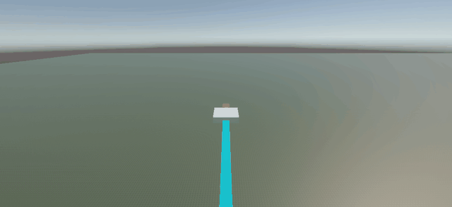
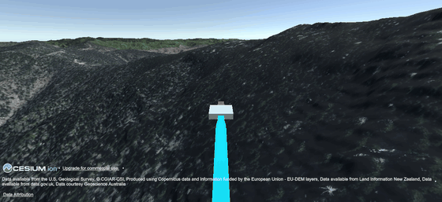
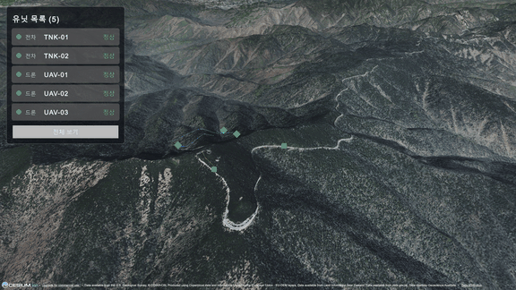
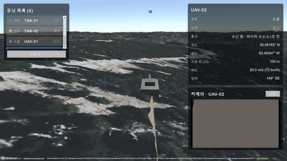
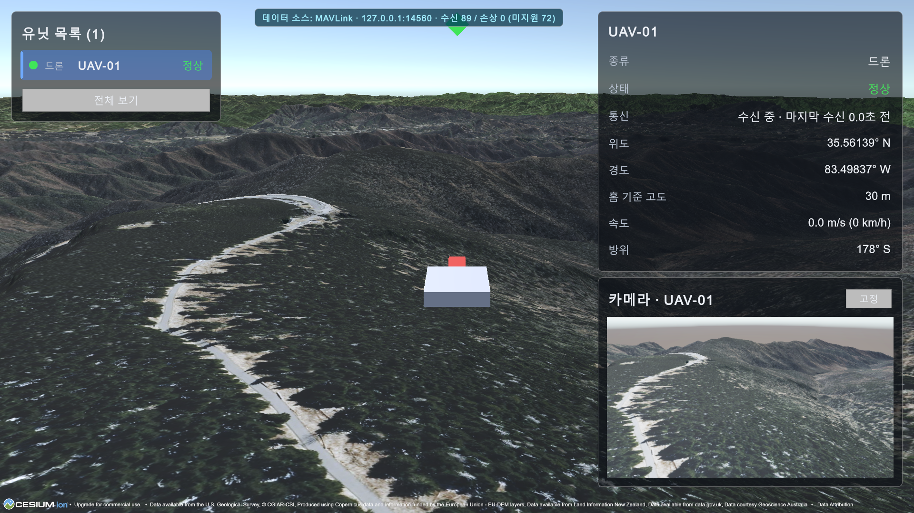
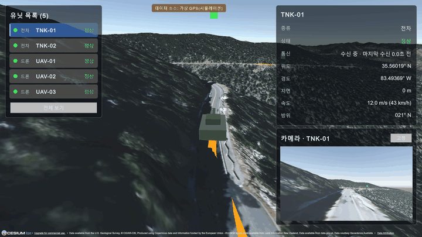
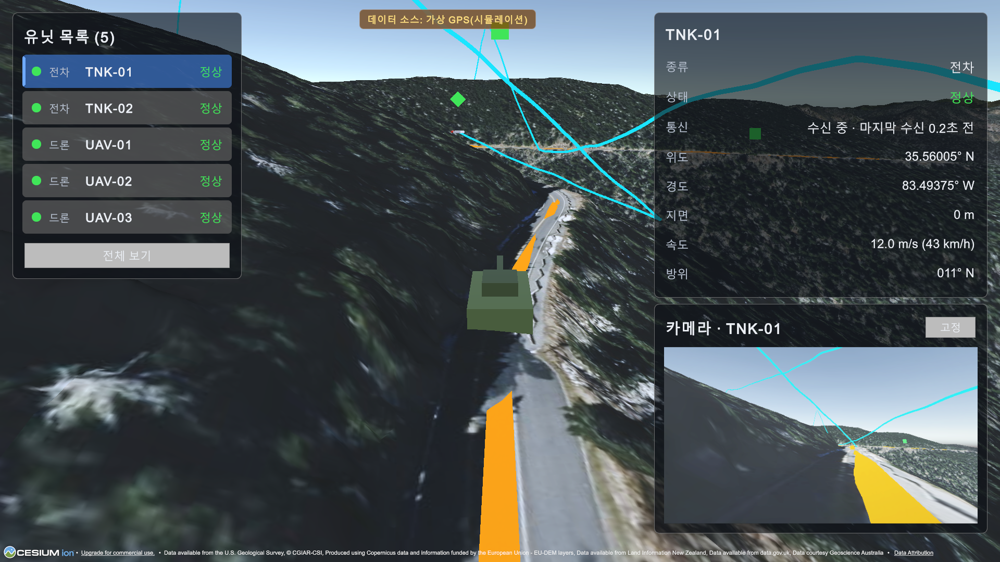
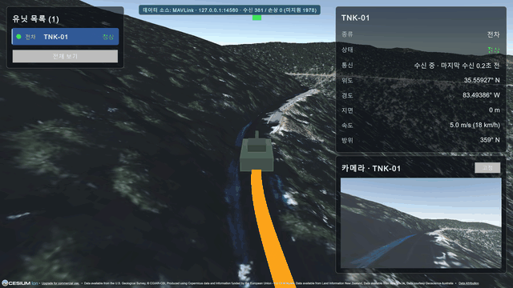
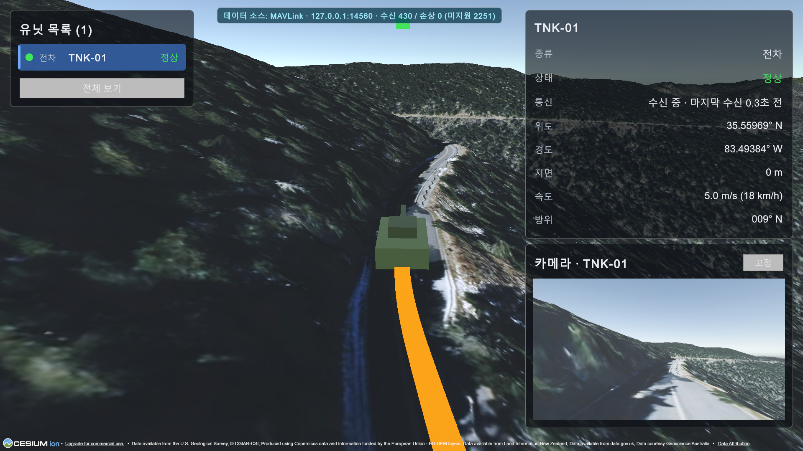

# 단계별 기록

프로젝트는 5단계 로드맵에 6단계를 더해 진행했습니다. 구현·검증·겪은 문제는 [devlog.md](devlog.md)에 정리했습니다. 처음으로 돌아가려면 [README](../README.md)를 보세요.

| 단계 | 내용 | 상태 |
|---|---|---|
| 1 | 평면 위 가짜 GPS 드론 이동·경로 표시 | 완료 |
| 2 | Cesium 실제 지형 위 이동, 지표 기준 고도 | 완료 |
| 3 | 다중 유닛(드론 3·전차 2) + 관제 UI | 완료 |
| 4 | 카메라 패널(선택·고정 2개), 시나리오 JSON | 완료 |
| 5 | MAVLink 시뮬레이터 연동(ArduPilot SITL), 데이터 소스 전환 | 완료 |
| 6 | Play 중 소스 전환 초기화, 전차 경로를 OpenStreetMap 실제 도로로 교체, 경과 시간 기반 이동 | 완료 |

## 1단계 — 평면 위 가짜 GPS

가짜 GPS 소스가 웨이포인트를 따라 위경도·고도·방위·속도를 발행하고, 드론이 이를 따라 이동·회전하며 경로선이 그려집니다.

## 2단계 — Cesium 실제 지형

Cesium World Terrain 위에 위경도 기준으로 드론을 배치하고, 지형 높이를 조회해 지표 위 80m를 유지합니다. 변환기만 교체했고 표시·데이터 소스 코드는 수정하지 않았습니다.

## 3단계 — 다중 유닛 + 관제 UI

드론 3기·전차 2기를 같은 지형 위에서 움직이고, 목록에서 선택하면 카메라가 따라가며 위치·고도·속도·방위·통신 상태를 보여 줍니다. 종류는 마커 모양, 상태는 색(정상/경고/두절)으로 구분합니다. 두절은 데이터가 끊긴 것을 수신 측이 시간으로 판정합니다.

## 4단계 — 카메라 패널

유닛마다 가상 카메라(드론은 기수 앞 30° 하향, 전차는 차체 전방)를 달고, 선택한 유닛의 영상을 패널에 표시합니다. `고정`으로 한 유닛을 패널에 남겨 두면 두 유닛을 동시에 볼 수 있습니다. 카메라는 선택·고정된 유닛만 렌더하며, 렌더 중인 카메라만 Cesium 타일 선택에 등록해 타일 부담을 패널 수로 묶었습니다. 경로·고도·속도는 시나리오 JSON으로 읽습니다. 드론은 `Assets/Scenarios/stage3-demo.json`, 전차는 OpenStreetMap 도로에서 만든 `Assets/Scenarios/osm-roads-tnk.json`입니다(출처·라이선스는 [README의 "데이터 출처와 라이선스"](../README.md#데이터-출처와-라이선스)).

## 5단계 — MAVLink 시뮬레이터 연동

ArduPilot SITL(Mission Planner)이 보내는 MAVLink v1·v2 텔레메트리를 UDP로 받아 유닛을 움직입니다. 수신 전용이며 요청이나 명령을 보내지 않습니다. 데이터 소스는 설정으로 가상 GPS와 MAVLink 사이를 전환하고(Play 중 전환하면 이전 소스의 유닛을 비웁니다), MAVLink 모드에서는 가짜 GPS로 대체하지 않으며, 수신하지 못한 유닛은 화면에도 나타나지 않습니다. 고도는 홈 기준(`relative_alt`)에 홈 지형 높이를 더해 지형 위에 놓습니다.

## 6단계 — 실제 도로 경로와 소스 전환 초기화

전차 경로를 OpenStreetMap의 실제 도로 선(쿠워히 접근도로)에서 만들었습니다. 변환 스크립트(`tools/osm_to_scenario.py`)가 도로를 구간으로 잘라 단순화·왕복 점열로 만들고, 가짜 GPS와 MAVLink 에미터가 같은 경로 파일을 읽습니다. 이동은 "속도 × 경과 시간"으로 경로 위 위치를 구하는 방식으로 바꿔 코너를 깎지 않고, 같은 시간이면 C#과 파이썬이 같은 위치를 냅니다. Play 중 데이터 소스를 바꾸면 이전 소스의 유닛·표시를 모두 비웁니다. 측정 결과 전차는 도로 중심선에서 평균 0.3–0.6m, 최대 1.5m 이내를 달립니다.

## 7단계 — 전차(Rover) SITL 연동

ArduRover SITL 1기(sysid 4)가 보내는 MAVLink를 받아 TNK-01을 전차로 인식하고 도로를 따라 움직입니다. TNK-01의 도로 경로를 Mission Planner 미션 파일로 바꿔(`tools/scenario_to_waypoints.py`) Auto 모드로 5 m/s 한 바퀴를 주행시켰고, 도로 중심선에서 평균 0.32m, 최대 1.9m 안에 머물렀습니다. Unity 수신·표시 코드는 고치지 않았습니다.

